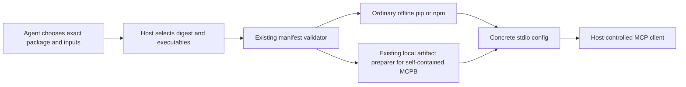

<Note>
This page retains advanced manual setup instructions from historical library
editions. The old private prerelease assets and verification records are not
republished by the public source export. For Connect 0.9.0, start with the
[quickstart](/connect/quickstart) and the
[public release list](https://github.com/lukacf/meerkat-connect/releases). Use only
the asset and manifest selected by those release notes; do not mix the historical
pins below into a new Connect distribution.
</Note>

An agent can research a server beyond the catalog and prepare an exact package
selection. A trusted local host can then use ordinary npm, pip or verified
self-contained MCPB materialization and obtain a stdio configuration for its MCP client. The installer does not
choose integrations or resolve vague requests.

<Note>
The exact `@modelcontextprotocol/server-filesystem@2026.8.31` selection passed
fresh installation and a separate restore on macOS arm64 with Node 24.19.0 under
network denial. This is evidence for that package and platform, not all Node
packages. The exact Python `mcp-server-git==2026.8.18` selection also passed a fresh
installation and separate restore under network denial on macOS arm64 with
CPython 3.11.15. Independent readback accepts this bounded component.
A separate Linux Python kit now has actual acquisition, recovery, offline
installation and local Fetch MCP fixture evidence. A fresh agent has also completed outside-catalog research and installation
through the released native host, followed by explicit same-session attachment.
Windows support, protected authentication and governed delegation/continuation
between native agents remain unfinished. This local
path does not change the current [`find_and_install` boundary](/connect/api/acquisition).
</Note>

## Use one host for the library and selected packages

The current combined [library edition](/connect/library/local-install) supports catalog
setup and selected Python and Node acquisition/installation in one MCP session.
Both platform archives also support MCPB inspection and installation.
Use the matching `20261008-canonical-mcpb` archive from the
private release (historical private asset; not included in this export),
verify it using the [current library guide](/connect/library/local-install#select-and-verify-the-archive),
then follow the extracted `selected/contracts/HOST-PREPARATION.md`.

If the setup client has not been prepared, the optional
`setup/bootstrap_host.py` command first installs and verifies the archive's
offline client, then generates those profiles. Follow the extracted root
guide and `selected/contracts/HOST-BOOTSTRAP.md`; supply a trusted Python,
archive hash and fresh client/configuration/workspace paths. No preexisting MCP
environment is required. This prepares the local host only: integration choice,
acquisition permission, sign-in and attachment keep their existing owners.
An existing verified client can still use `prepare_host.py` directly.

The current edition's `setup_guide` tool returns the enabled metadata and
installer contracts as frozen, bounded text through MCP. The root installation
commands bind the actual archived manifest hashes. These guides confer no
authentication or execution authority. See
the [current library guide](/connect/library/local-install) for pins and limits.

For a public MCPB URL, the explicit `--mcpb-acquisition-profile` and
`--mcpb-acquisition-profile-sha256` pair enables `setup_acquire_mcpb`. Add
`--allow-mcpb --enable-mcpb-inspection` and the selected Node pin. The agent
chooses the URL and checksum; the host approves download origins. Follow
`selected/contracts/MCPB-ACQUISITION.md` for downloads, redirects and exact-job
recovery inspection. Authentication and native attachment remain separate.

For container-backed integrations on Mac or Linux, use the ordinary helper
with `--compose-acquisition-host-profile` and its SHA-256 to permit image
acquisition. Execution has a separate `--compose-backend-profile` pair, graph
path, new/reopen mode and explicit allowed actions. Neither is enabled by
default. Read the archived `HOST-PREPARATION.md` and `COMPOSE.md` for exact
inputs and the supported platform's Docker/Compose requirements.

For selected Node package installation, the helper takes a complete runtime quartet: `--selected-node`,
`--selected-node-sha256`, `--selected-npm-cli` and
`--selected-npm-cli-sha256`. It keeps library `--node`/`--npm-cli` separate, so
Linux Activepieces retains Node 22/npm 10 while Node acquisition uses Node
24/npm 12. The existing installers remain the runtime validators.
Public npm acquisition additionally requires `--allow-public-npm`,
`--npm-archive` and `--npm-archive-sha256`; public PyPI keeps its independent
opt-in and pinned pip tool. These inputs do not launch a selected server or
authenticate an account.

For Mac or Linux MCPB setup, add `--allow-mcpb --enable-mcpb-inspection` to
`prepare_host.py` and supply
`--selected-node` plus `--selected-node-sha256`. MCPB alone needs no selected
npm runtime. With a host-staged `artifact.mcpb` and its exact hash, the agent
uses `setup_inspect_mcpb` to read its manifest and selected source before
choosing configuration and metadata. The existing selected check, install and
reconcile tools own the next steps. The retained first-use trial converted
100 cm to 1 m through the emitted MCP and separately reconciled after restart.
See `docs/verification/20261004-mcpb-onboarding/REPORT.md`. The current Linux
archive separately passed the retained GeoPrims installation, conversion and
fresh-process readback, preserving all 371 installed files. The same release's
starter does not expose this opt-in. Native Connect's compiled library resources
are unchanged.

The acquired-inspection predecessor macOS archive passed a guided fresh-agent trial: from a vague
Python Fetch clue, the agent researched a package, inspected its acquired
archive through MCP, authored metadata, installed it and answered a synthetic
local question. Both requests passed restart readback. The earlier onboarding
delivery added static Linux verification and host-preparation checks; the new
Linux MCPB evidence above is separate. An earlier Linux archive passed a combined Activepieces Tally and selected Node
filesystem-server scenario, including acquisition, installation, three-request
recovery and a local file query with an outside-path refusal. Neither scenario
uses live account authentication or native attachment. The
standalone kits below retain their original scope, including separately supported MCPB and Compose
paths; they are not prerequisites for the combined Python/Node session.

Add `--enable-package-inspection` during host preparation to expose the
canonical inspector as `setup_inspect_package`. The agent can submit exact
nonsecret `package_json` and `activation_json` strings to
`setup_selected_check`, without writing staging metadata. Inspection returns
the typed package digest needed in the activation; installation remains a
separate call. Each document is limited to 32 KiB UTF-8 and the complete encoded
request to 64 KiB. The shipped `selected/contracts/METADATA.md` and
`SETUP-SELECTED.md` specify both inline and staged-file forms.

Add `--enable-acquired-inspection` to expose `setup_inspect_acquired` for
succeeded live Python/Node acquisition jobs. The agent can list the primary
archive and read bounded UTF-8 source without executing package code. It still
chooses the entrypoint and authors metadata. Dependency archives are excluded.
After restart, an explicitly enabled reader can inspect a recovered acquisition
only after a matched reconciliation and with the original matching selected
profile plus current trusted tools. Historical status remains unconfirmed; no
install or acquisition authority is restored. See the shipped
`ACQUIRED-INSPECTION.md` contract and
`docs/verification/20261004-recovered-archive-inspection/REPORT.md`.

## Linux Python and Node kit

Use `dist/agent-install-kit-20261004-node-linux/README.md` and verify archive
SHA-256 `a5a75067b5e9c554dac3e2bde843152a8e9ceedd1c9b6bbc91c2eaa4be34cb46`.
This kit supports selected Python and Node acquisition, installation and
retained-file readback on Linux x86_64. Its inherited offline MCP bootstrap
requires native 64-bit CPython 3.11.16 with glibc 2.39. The host supplies the
runtimes, trusted acquisition tools and public registry access. Node acquisition
requires native Node 24.15 or later within major 24, complete pinned npm 12.2.0,
and `target: linux-x86_64` in its host profile. Follow the extracted Linux guide;
the macOS commands below do not select its tools. MCPB and Compose executables
are not included.

The earlier Python delivery passed known-package Fetch acquisition, restart,
offline installation and a real MCP fixture call, recorded at
`docs/verification/20261004-selected-python-linux/REPORT.md`. The Node addition
passed actual Linux source and extracted-kit acquisition, fresh-process
recovery, offline installation and installed filesystem MCP use, including an
exact outside-directory refusal. The evidence and independent archive review
are recorded at `docs/verification/20261004-node-linux/REPORT.md`. These checks
do not establish authenticated provider use or native continuation.

## From discovery to an answer

A fresh agent was given a synthetic receivables question, database path, host profile and kit, with no selected package, schema or SQL. It researched `sqlite-mcp-server==0.1.7`, prepared a compatible dependency closure, installed it and used the packaged MCP checker to inspect the schema and execute its own query. The returned top three customers and overall balance matched an independent preexisting oracle; the database stayed unchanged.

The same agent performed the research, installation and final calls. The host reviewed effects and corrected a sandbox rule that had blocked `/dev/null`; the initial failure and new policy revision remain in the evidence. The unchanged kit passed after that host correction. This demonstrates local task completion. Later released-runtime trials also prove explicit host-mediated attachment and same-session use; protected account authentication, governed setup delegation and durable continuation after process loss remain unfinished. The checkout retains the full record at `docs/verification/20261003-agent-outcome-database/REPORT.md`.

## Let the setup agent install its choice

The standalone kit includes a stdio setup MCP server. The host enables the
permitted Python, Node or MCPB profiles and pins their supplied tools. The agent
stages its researched inputs, calls `setup_selected_check`, reviews the returned
proposal and calls `setup_selected_install` with that proposal's ID and digest.
The same job, readback and recovery operations apply to all three formats.

The current kit also offers `setup_acquire_python`, `setup_acquire_node` and
`setup_acquire_compose` when the host enables the corresponding pinned profile.
Python and Node acquisition prepare exact artifacts and dependency closures for
the same selected installer. The agent still chooses the integration and authors
its metadata. Compose acquisition produces a container graph proposal for
separate host execution admission. The extracted `contracts/PYTHON-ACQUISITION.md`,
`NODE-ACQUISITION.md` and `COMPOSE-ACQUISITION.md` specify the profiles and limits.
The host supplies trusted package-manager tools or its selected engine; none of
these acquisition tools supplies provider authentication or native attachment.

For MCPB, the four inputs are `package.json`, `activation.json`,
`configuration.json` and `artifact.mcpb`. The check request binds the raw package,
activation and configuration hashes. Use the kit's optimized installer; its
archive check and readback have a 120-second budget. The current standalone
contract is `contracts/SETUP-MCP.md` inside the archive, including the exact host
profile and command. The source counterpart is `sdk/consumer-setup/SELECTED.md`.

An optional local browser shows the same running controller's jobs, including
earlier installations. It also shows Python, Node and Compose acquisition
status, exact-job Stop and retained inputs or proposals. Acquisitions are not
presented as installations or connected tools. Restarting the controller does not restore its entire
history; explicit recovery opens one retained request for readback. These tools
install software. The host still owns credentials, process launch and native
attachment.

Acquisition requests also support this one-request recovery. Keep the returned
`recovery_request` and original workspace, then follow the kit's
`contracts/ACQUISITION-RECOVERY.md` after the original worker has stopped. The
new session exposes only state and file checking. It can return matching Python
or Node staging inputs or a retained Compose proposal without downloading or
pulling again. The old job stays historically unconfirmed; a file match does not
establish current image availability or tool readiness.

For ordinary use after installation, a Meerkat host can follow the
[native MCP handoff](/connect/guides/native-mcp) to configure the exact emitted launch
before a new session. This uses existing host configuration and deferred tool
loading; it does not supply dynamic acquisition or account authentication.

An earlier extracted macOS kit was exercised with a preselected real MCPB bundle:
offline client bootstrap, installation, one ordinary tool call, same-job replay,
fresh-process recovery and tamper detection pass with repository and network
access denied. This verifies local delivery; it is not another discovery-agent
or protected authentication test. The record is
`docs/verification/20261004-mcpb-setup-distribution/REPORT.md`.

## Install an exact choice

The current standalone macOS arm64 kit is
`dist/agent-install-kit-20261004-acquisition-recovery`. The canonical new-host
command path is `agents/setup-installer/HOST-SETUP.md` in the source distribution;
it pins this edition's archive, installer and selected Python validator.
The kit contains the inspector, Python and Node validators and installer, the
self-contained Node MCPB installer, Compose planner/runtime, local recipe command,
one-shot MCP checker, agent guide and contracts. Verify its sibling `SHA256SUMS`,
extract it and follow its root `README.md`; using the kit needs no Toolkit checkout.
Supply compatible host runtimes, research tools and the complete request.
The agent chooses the integration and prepares the exact inputs. Host executable
runtimes and the selected integration remain separate. The optional offline
checker environment contains the unconfigured services package and its MCP SDK
dependencies for CPython 3.11/macOS arm64. Ordinary host-mediated native
attachment is described in the [released native MCP guide](/connect/guides/native-mcp);
governed attachment and durable continuation remain unfinished.

This edition includes selected-install retry and services 0.1.7 with fixed
Slack channel configuration. Its inventory and acquisition browser checks
are recorded in `docs/verification/20261004-acquisition-browser/REPORT.md`.
The predecessor's extracted acceptance covers proposal-only retry, explicit
installation, recovery, omitted/empty/explicit channel lists and a real SQLite
read through released Meerkat. That native check uses a deterministic model
fixture; protected login and dynamic acquisition remain unfinished. Its record
is `docs/verification/20261004-scoped-retry-kit/REPORT.md`.

The checker also accepts a version-2 `action: "discover"` request with the same
pinned launch and no expected schemas or calls. It returns the complete bounded
SDK-visible tool declarations without invoking a tool. The agent reads those
descriptions and schemas, chooses useful operations and prepares a separate
version-1 call request. The kit's `contracts/MCP-EXECUTION-CHECK.md` gives both
formats. Declarations are untrusted server data; listing does not authorize a
call or guarantee that a later connection advertises the same tools.

For an already hosted HTTPS Streamable HTTP endpoint, the same checker accepts
version-3 `discover` and `call` requests. It reads the selected portable
`mcp.json` directly, so no local server package is required. The host supplies
literal headers through its existing credential owner. TLS stays verified;
the checker does not log in, follow redirects or inherit proxy and cookie state.
See `contracts/MCP-EXECUTION-CHECK.md` for the exact request format and limits.
A local test exercises the delivered checker against a real MCP SDK server
over HTTPS, using the existing portable export. It is not live provider evidence.

The recipe command can initialize an empty store and retain exact choices for
Python, Node, MCPB and already hosted MCP endpoints. With explicit host opt-in,
the setup agent can save its researched hosted recipe and export ordinary MCP
configuration. Public endpoints support explicit anonymous access; authenticated
recipes still require their credential binding. A rejected recipe gets specific
repair guidance only when rejection is proven to precede opening the store.
Reading a saved choice or exporting configuration does not authorize a call.

The same kit supports bounded recipe pages, explicit retry after failed library
preparation or an unconfirmed hosted export, fresh-session export readback and
reuse of official GitHub/Playwright configurations. Its offline bootstrap carries
services 0.1.7 base. The official artifact bundle remains a separate host input.
The earlier current-setup-kit trial verified these paths under repository and
network denial. A Python 3.12/MCP 1.30 host client also read the pinned 101-entry catalog through
the separate Python 3.11/MCP 2.2 server. These checks establish delivery and
protocol interoperability for that predecessor, not provider authentication or native acquisition.
The record is `docs/verification/20261004-current-setup-kit/REPORT.md`.

Use the matching trusted validator and complete retained package inputs. In the
examples below, `/absolute/agent-install-kit-macos-arm64` is the extracted kit and
`/absolute/host-scratch` is an existing writable directory outside both the input
bundle and installation destination.

<Steps>
  <Step title="Select the exact inputs">
    The host reviews the agent's `IntegrationPackage` and `ActivationManifest`,
    then selects the raw `activation.json` SHA-256 and the executable paths.
    The manifest binds the package metadata, primary server artifact and every
    dependency input. Keep these documents free of secrets.
  </Step>
  <Step title="Install into a new directory">
    Use absolute paths. The destination's parent must exist and remain under
    the operator's control. Replace the example component ID with the selected ID.

    <Tabs>
      <Tab title="Python">
    ```sh
    env -i PATH=/usr/bin:/bin TMPDIR=/absolute/host-scratch \
      /absolute/python3.11 -I -B /absolute/agent-install-kit-macos-arm64/bin/install-library-consumer.py \
      --selected-python /absolute/reviewed-python-bundle \
      --selection-sha256 HOST_SELECTED_RAW_ACTIVATION_SHA256 \
      --component python-server \
      --validator /absolute/agent-install-kit-macos-arm64/bin/toolkit-python-plan \
      --python /absolute/python3.11 \
      --destination /absolute/new/selected-python-install
    ```
      </Tab>
      <Tab title="Node">
    ```sh
    env -i PATH=/usr/bin:/bin TMPDIR=/absolute/host-scratch \
      /absolute/python3.11 -I -B /absolute/agent-install-kit-macos-arm64/bin/install-library-consumer.py \
      --selected-node /absolute/reviewed-node-bundle \
      --selection-sha256 HOST_SELECTED_RAW_ACTIVATION_SHA256 \
      --component node-server \
      --validator /absolute/agent-install-kit-macos-arm64/bin/toolkit-node-plan \
      --node /absolute/node \
      --npm-cli /absolute/npm/bin/npm-cli.js \
      --destination /absolute/new/selected-node-install
    ```
      </Tab>
    </Tabs>

    Both modes validate frozen inputs and check the complete artifact closure.
    Node uses offline npm with scripts and binary links disabled. Python uses
    a fresh venv and offline pip with exact wheel hashes and no source builds.
    Installed files and dependency versions are verified before publishing the
    client configuration. Installation does not launch the selected server.
  </Step>
  <Step title="Connect the ordinary MCP client">
    After installation succeeds, use `ready/mcp.json` in a host that accepts
    `mcpServers` stdio entries. `ready/installed.json` records the software
    identity and exact launch command. The host supplies a deliberate launch
    environment, initializes the connection and checks its actual tool contract.
  </Step>
</Steps>

The client receives the **whole server**. A read operation declared in the
selection does not hide its write tools or authorize them. The host owns
authentication, resource access, operation approval and process shutdown.
The emitted configuration does not clear environment variables inherited by
the client's child process. `ready` identifies completed installation checks,
not protocol, account or business readiness.

For both the verified installation and restore, the official Python MCP client
consumed the Node configuration, initialized, listed 14 tools, read a
task-owned fixture, observed denial outside the selected directory and closed.
The checkout retains the result at
`docs/verification/20261003-selected-node/final-delivery/acceptance.json` and the
component record at `docs/verification/20261003-selected-node/acceptance.json`.
See [validation](/connect/contributing/validation) for the distinction between these
observations and full product completion.

For each Python environment, the generic MCP client consumed the emitted
configuration, initialized, listed 12 Git tools, read the exact fixture commit
with `git_show` and closed. The observed read schema matches the selected digest.
The closure contains 33 selected wheels plus the two fresh-venv bootstrap
distributions. Each installation verifies 996 retained payloads and preserves
1,646 bootstrap files; 107 pip-generated file hashes are recorded separately.
The execution receipt is
`docs/verification/20261003-selected-python/attempt2/acceptance.json`; the
independent physical-installation readback is
`docs/verification/20261003-selected-python/independent-review/final-readback.json`.
This local read requires no provider credentials and proves no native agent
workflow, Git permission boundary or protected authentication flow.

## Inspect a lost installation response

The standalone agent installation kit includes `--verify-existing` for selected
Python and Node installations. Supply the same
original input directory, raw selection digest, component, trusted validator,
runtime path and existing destination. Node readback does not require npm.

The command runs the trusted metadata validator on private temporary copies under
the supplied `TMPDIR` (or `/tmp` when unset),
then compares retained package payloads and the published launch binding. It
does not repair, reinstall or start the integration. Keep exclusive host custody
of the inputs, executables and destination during inspection.

A match has scope `retained_payload_and_launch_binding_only`. Runtime bytes and
compatibility, Python bootstrap integrity, generated-file provenance, account
access and current readiness remain outside that observation. Preserve an
unconfirmed result for investigation rather than automatically reinstalling.

## Install a self-contained Node MCPB

`toolkit-mcpb-install` uses the same package and activation documents and the
existing local artifact preparer. It accepts an explicitly selected MCPB 0.3
archive containing its runtime files, with one independent local Node service
and no authentication requirement. It does not run npm or download missing
files. Supply every supported nonsecret string configuration field explicitly;
the installer checks the manifest substitutions against the selected literal
arguments and never applies a default.

```sh
env -i PATH=/usr/bin:/bin \
  /absolute/agent-install-kit-macos-arm64/bin/toolkit-mcpb-install install \
  --package /absolute/package.json \
  --selection /absolute/activation.json \
  --selection-sha256 HOST_SELECTED_RAW_ACTIVATION_SHA256 \
  --component SELECTED_COMPONENT_ID \
  --artifact /absolute/server.mcpb \
  --config /absolute/configuration.json \
  --config-sha256 HOST_SELECTED_RAW_CONFIGURATION_SHA256 \
  --node /absolute/trusted/node \
  --destination /absolute/new/installation
```

The installer verifies the archive and extracted files, checks Node's version
and publishes `ready/installed.json` with `ready/mcp.json`. It never starts the
donor server. To inspect an uncertain result, use `verify` with the same inputs
and destination, omitting `--artifact`. Verification reopens the retained bytes
and compares the receipt; it does not repair or reinstall. Restore by installing
into a separate new directory. The existing host owns any binding switch.

The real Geoprims 0.1.0 bundle passed two local installation/restore checks and
six ordinary MCP calls on Node 24.19.0/macOS arm64 under network denial. Its
explicit `navigation` toolset exposes 46 tools. The installed client checked
the unit-conversion schema, converted 100 cm to 1 m and observed two input-error
cases. Lost-response verification and three tampering refusals also passed.

Two donor compatibility problems remain visible: its declared empty toolset
default fails at launch, and its advertised modern MCP protocol fails response
validation. The tested host explicitly uses the older initialize handshake,
negotiating `2025-11-25`; the standard Python client calls this `legacy` mode.
Standard `mcp.json` contains no client-specific negotiation setting. A host must
select and verify its own protocol options before reporting protocol readiness.

This proof is recorded in `docs/verification/20261003-mcpb-geoprims/attempt3`.
The full CLI/profile contract is `crates/toolkit-package/MCPB-INSTALL.md`.
The donor archive is retained for local verification; public redistribution and
broad scientific accuracy are not established. Linux execution, other MCPB
runtimes, protected configuration and native acquisition remain unfinished.

## Check the installed server

After installation, the agent can use the included `bin/toolkit-mcp-check.py`
through a host-selected Python environment. The extracted kit's
`contracts/MCP-EXECUTION-CHECK.md` explains its offline bootstrap and exact
request format; the repository guide is `docs/guides/mcp-execution-check.md`.

The host supplies the pinned `ready/mcp.json`, expected tool schemas, literal
environment and authorized calls. The checker enumerates the endpoint, compares
the complete selected schemas before each call and uses the MCP SDK to make
each chosen call once. Extra advertised tools are reported but never selected
automatically. An error, input-required response or uncertain result stops later
calls. The agent assesses whether the returned content answers the original request.

This starts the actual selected server and is separate from file-only installation
readback. The SDK owns transport and cleanup. A successful report establishes
observed responses; it does not establish authentication, native tool attachment
or original-task continuation. Its output limits apply after SDK parsing, so the
host still supplies process and resource controls.

## Prepare a package outside the catalog

The reusable setup-agent instructions live in
`agents/setup-installer/instructions.md`. Supply the complete original request,
the actual permitted tools and the host execution profile. The agent researches
the implementation, chooses its version and entrypoint, downloads the ordinary
package-manager dependency closure, and authors the two canonical documents.
Host facts and permissions must come from the host, not from the model.

After authoring `package.json`, obtain its canonical digest from the existing
package owner:

```sh
/absolute/toolkit-package-inspect integration-package < package.json
```

Use `summary.package_content_digest` in `activation.json`. The raw file digest
is a different value. The current kit supplies the inspector as
`bin/toolkit-package-inspect`; it validates metadata without executing the
selected package. Validate the completed selection with the matching
`toolkit-python-plan` or `toolkit-node-plan`, then use the host's existing
effect-admission path and installer. Existing authority can permit proceeding
without another human confirmation.

A fresh setup-agent trial exercised this path from a vague clock-tool request.
The agent selected Time MCP, prepared its own metadata and 32-wheel closure, and
ran the existing installer. The host verified the emitted MCP connection,
Tokyo current time and Stockholm-to-Kolkata conversion with networking denied.
Independent review checked the prepared inputs and installed payloads. The
retained record is `docs/verification/20261003-agent-prepared-install/REVIEW.md`.
That trial did not exercise native attachment. Later released-runtime trials
prove explicit host-mediated same-session attachment; governed delegation and
durable original-task continuation remain unfinished.

Both bundles retain the same canonical `package.json` and `activation.json`.
Their runtime-specific input layouts are:

<Tabs>
  <Tab title="Python">
```text
package.json                 Toolkit package metadata
activation.json              exact typed selection
artifact.whl                 unchanged selected server wheel
closure/requirements         complete exact versions and SHA-256 hashes
closure/dependency-1.0-py3-none-any.whl
```

The primary wheel's original filename comes from its artifact URL. Dependency
IDs retain their original wheel filenames. The manifest binds all these bytes;
the installer restores the primary filename for ordinary pip. No package name
or dependency is inferred from the user's wording.

The selected relative `.py` entrypoint is the sole launch declaration. For
example, `mcp_server_git/__main__.py` yields `python -I -B -m
mcp_server_git.__main__`, followed by the literal selected arguments. The
installer verifies that the primary wheel owns the module and its parent
packages. The profile refuses `.data` relocations, startup hooks, bytecode and
module-shadowing conflicts. It verifies the exact wheel payloads, bootstrap,
distribution versions and installed file graph. Pip-generated `RECORD` and
script hashes are recorded separately; their bodies and optional console
entrypoint usability are not claimed as retained-wheel verification.

The Git example requires a trusted Git executable and deliberate Git
configuration from the launching host. `--repository` selects a repository;
it does not establish a permission grant or an OS sandbox. The full Git server,
including its write tools, is exposed to the client.
  </Tab>
  <Tab title="Node">
```text
package.json                 Toolkit package metadata
activation.json              exact typed selection
artifact.tgz                 selected npm server
closure/package-json         npm project declaration
closure/package-lock         unchanged npm lock version 3
closure/archive-ID           each selected dependency archive
```

The npm project's only dependency points to `file:./artifact.tgz` and its
`private` field is `true`. The manifest's `PinnedClosure` records the exact
project files and all archives. Nested dependency versions are supported.
Its entrypoint is a retained JavaScript file in the primary package with literal
arguments. The installer does not download missing dependencies or choose newer
versions.
  </Tab>
</Tabs>

The typed examples and supported inputs are documented in
`crates/toolkit-package/PYTHON-INSTALL.md` and
`crates/toolkit-package/NODE-INSTALL.md` in the checkout. The ordinary library
bundle has its separate [installation guide](/connect/library/local-install).

## One selection owner, one ecosystem installer



`IntegrationPackage` and `ActivationManifest` remain the metadata owners.
`NodeInstallPlan` and `PythonInstallPlan` are derived projections; a saved plan
is not authorization.
The installer invokes the trusted validator afresh on its frozen documents.
This supplies a local installation step that a future setup host can compose
with the existing [acquisition design](/connect/concepts/acquisition).

For an update or software restore, install the separately selected inputs into
another new directory. The host switches consumers and closes the previous
process. A failed attempt retains an unused partial directory and logs; fix the
cause before selecting a new destination. Neither restoration nor switching
replays operations, restores credentials or grants, or migrates provider state.

## Acquire the selected Python inputs

An optional host-enabled `setup_acquire_python` tool accepts the agent's exact
public PyPI distribution and version. It resolves wheel dependencies with
trusted pip and stages the original files and hashes. The agent then authors
the canonical package and activation documents and uses the existing selected
check/install tools. This removes manual wheelhouse assembly while preserving
the agent's integration choice and the installer's validation.

The host pins Python and pip and explicitly permits public PyPI network access.
The current profile supports CPython 3.11 on macOS arm64. It is not an egress
sandbox, account connection or native acquisition implementation. Exact
configuration and replay/cancellation semantics are documented in the extracted
`contracts/PYTHON-ACQUISITION.md`, with source counterpart
`sdk/consumer-setup/PYTHON-ACQUISITION.md`.

## Container-backed selections

The optional `setup_acquire_compose` tool prepares a selected container graph
and downloads immutable images from host-allowed registries. The existing
planner owns graph validation and the Compose runtime owns engine observations.
The returned proposal then goes through host admission and the existing
Compose execution capability. See the extracted `contracts/COMPOSE-ACQUISITION.md`
and `COMPOSE-PROPOSALS.md` for host configuration, cancellation and exact replay;
the source counterpart is `sdk/consumer-setup/COMPOSE-ACQUISITION.md`. Image acquisition alone
does not start containers or attach a native agent capability.
