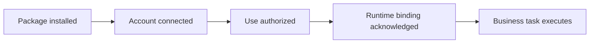

Connect is reusable because it composes existing owners. Each fact has one authority; other components carry references or projections of that fact.

Meta has no Connect dependency, including an optional dependency. Connect owns
the adapters that consume generic native and Meta interfaces. The application
explicitly opts into those adapters and supplies its existing policy and
lifecycle owners. Connect-specific integration behavior belongs in Connect,
while those upstream interfaces remain usable independently.

| Owner | Responsibility | Connect's relationship |
| --- | --- | --- |
| Meerkat | Agents, sessions, native execution, mob lifecycle and runtime tool surfaces | Use accepted native operations and receipts |
| Meta | Application startup, routing, delivery and host composition around Meerkat | Offer optional integration capabilities to selected agents |
| Connect | Packages, recipes, adapters, integration setup records and reusable UI | Describe and validate selections; compose effects through their owners |
| Host application | People, policy, approval, connection selection, domain behavior and deployment decisions | Inject explicit services and enforce actual authority |
| Credential owner | Tokens, secret handles, refresh, revoke and credential audience | Borrow a selected transport or an opaque handle |
| Provider or device | External account state and realized effects | Return bounded observations; reconcile uncertain effects |

## Distinct facts

An installed package makes bytes available. A connection selects an authenticated account. A grant permits particular use. A runtime binding makes an operation available to the intended agent or consumer. A readiness result reports the required current acknowledgments. The business task succeeds only when its own work completes.

This diagram illustrates dependencies, not a universal state machine. A package can serve several accounts; one connection can have several grants; a deployment identity can avoid human authentication entirely.

## Agent judgment and mechanical checks

Setup agents interpret the user's request, research candidate integrations, compare strategies and assess whether an operation meets the task. They may ask a focused question when a material choice remains ambiguous.

Code checks exact identities, manifests, compatibility, policy, account observations, resource constraints and owner revisions. It must not guess the intended integration from keywords or silently replace a failed strategy with another.

## Application reuse

A home-automation host retains household policy, recipients and domain behavior. Reachy retains physical-safety policy and device semantics. Organizational hosts retain tenant, administrator and audience policy. These hosts can share Connect packages and adapters without sharing their private agent runtimes or assuming identical deployment privileges.

See [architecture](/connect/reference/architecture) for the crate boundaries and [host composition](/connect/guides/host-composition) for practical integration steps.
