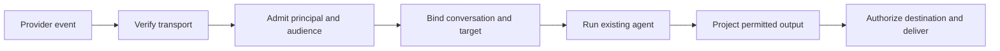

A **service connector** exposes operations or service events. An **agent frontend** admits external interaction and delivers an allowed response. These are export roles, so a package can contain either or both.

A frontend uses a persistent application host for participant identity, conversation routing and delivery. The service connector uses the selected account and operation permissions.

<Tabs>
  <Tab title="Service connector">
    "Read updates in this Slack channel" needs selected account access, permitted read operations, resource constraints and a runtime binding for the acting agent. It does not publish a bot or expose the agent's conversation.
  </Tab>
  <Tab title="Agent frontend">
    "Let Support talk to this assistant in Slack" needs a transport installation, admitted people, a target agent, conversation policy, reply destination and permitted service authority. It need not give the original setup requester any new tools.
  </Tab>
  <Tab title="Both roles">
    "Answer support-channel questions using our documents" can require document-reading service access and a Slack frontend. Report each outcome independently while either remains pending.
  </Tab>
</Tabs>

## Service-event consumers

A Home Assistant state event or calendar webhook can feed a declared application consumer. Event delivery must specify replay, cursors, ordering, backpressure and loss behavior. An event body is not a trusted instruction and cannot promote itself to a human request.

## Frontend boundaries

A valid provider signature establishes transport origin. It does not establish the author's application permissions. Provider channel/thread IDs are namespaced lookup keys, not session authority. A Slack thread does not create a visibility ACL separate from its channel.

Inbound routing, semantic delegation and outbound delivery are distinct jobs. A host may support a fixed agent, an authorized selection or a routing agent. Connect exposes only that host's supported choices. HomeCore routes admitted senders to their own agents and has no destination-agent selector. Semantic specialist selection stays with the agent; exact lookup follows the chosen binding.

## Independent lifecycles

Pausing a frontend blocks new admission according to its policy. Removing it does not delete the agent, erase memory or revoke unrelated service connections. Disconnecting shared credentials may degrade both roles and should report that dependency.

Routes, daemons, event subscriptions and live sessions are supporting components. They do not form a third product role or imply that a process being healthy makes an integration ready.

Continue with [service authoring](/connect/guides/service-connectors) or [frontend authoring](/connect/guides/agent-frontends).
