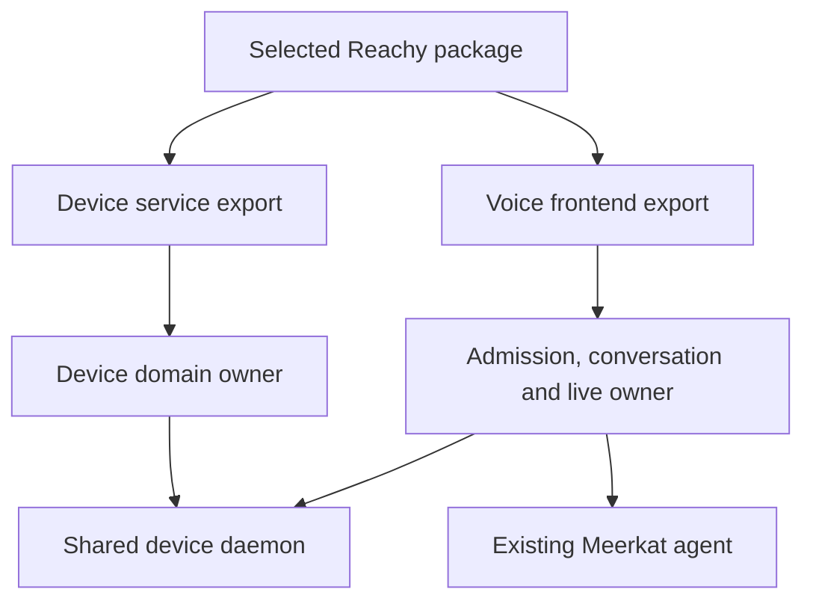

A Reachy-style integration can expose both device operations and a voice frontend while sharing one daemon and domain service.

## Declare the components

| Component | Required contract | Readiness evidence |
| --- | --- | --- |
| Device daemon | Exact artifact/configuration, lifecycle, state and health | Current device/domain handshake |
| Device service export | Explicit operations, resource identity and domain policy | Authorized operations bound to the intended consumer |
| Voice frontend export | Participant admission, conversation, output and live media | Exposure acknowledgment plus live/playback acknowledgment for an admitted session |
| Camera/image path | Job identity, socket association and bounded transport | Canonical image acceptance for the original job |

Supporting process health is necessary where declared, but it cannot replace any role acknowledgment.

## Select the role

Choose device service operations, a voice frontend, or both. Declare shared daemon dependencies in the package and give each role its own access and lifecycle policy.

A service-only configuration can keep voice disabled. A combined configuration binds device operations and live interaction to the same domain service while retaining their distinct permissions.

## Preserve physical authority

Physical-control and safety-monotone operations need their domain contracts. A host lacking the selected safety contract cannot relabel movement as an ordinary write. Tool arguments do not establish device ownership, a current control lease, emergency-stop state or a safe operating area.

Authentication, installation and a local simulator run do not establish physical completion. The domain owner defines permitted validation and produces the actual device observations.

## Keep live interaction bound

A configured voice frontend opens a live session only after an interaction is admitted. Media state stays with the canonical live owner. Image results remain associated with the original job and socket; an HTTP 200 alone cannot prove the runtime accepted the image into that session.

A lost socket does not authorize routing images into a replacement session. Reconnection, cancellation and uncertain acceptance need their actual owner recovery path.

## Upgrade and remove safely

The package describes shared dependencies and state migrations. Pause the frontend according to its admission/live policy; revoke device access through its grant/domain owner. Stop the shared daemon only when its remaining dependants permit it. Preserve durable state required for recovery.

This example should remain implementable in another host. Keep Reachy domain behavior in its adapter and application while reusing Connect packaging, delivery and transport pieces and the existing Meerkat/Meta runtime.
