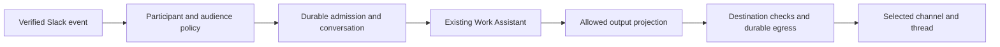

"Read last week's Slack updates and email me" requires Slack reads and an authorized email-send service. It does not require a Slack bot frontend or an email assistant inbox.

The [standalone Slack/Gmail MCP component](/connect/library/slack-gmail) now exposes the
selected reads and exact-byte Gmail send through an ordinary configured MCP
process. The direct Python example below is an alternative for embedding hosts.

## Read a bounded interval

The host supplies an already selected, authenticated and prepared HTTPX client. It authorizes both the requested creation window and the older-root discovery window before calling this function.

```python
from meerkat_toolkit.connectors.slack import SlackOperations

async def collect_updates(prepared_slack_client, channel, *, start, end, root_oldest):
    slack = SlackOperations(prepared_slack_client)
    return await slack.read_interval(
        channel,
        start=start,
        end=end,
        root_oldest=root_oldest,
        max_requests=40,
        max_messages=2000,
        page_limit=15,
    )
```

`start`, `end` and `root_oldest` are exact decimal timestamp strings chosen by the caller. The host resolves "last week" with the intended time zone before this operation; the library performs no natural-language time parsing.

The result reports selected message occurrences, history/thread chain outcomes, `termination`, limits and `coverage_gaps`. It preserves duplicates and conflicts. A positive older-root floor always leaves older roots unsearched, and even exhausted visible chains do not prove an immutable complete Slack snapshot.

## Continue a partial read

Python and TypeScript can resume the
same interval operation. Set `resumable=True` in Python (`resumable: true` over
MCP), then pass a returned nonnull `continuation` on a later authorized call.
Keep the same account and query selection; per-call request/message budgets may
change. The caller chooses when to retry and observes any `Retry-After` value.

Each part contains only that call's observations. Retain all parts and their
coverage gaps for the summary. A null continuation means the pending queue is
empty, not that the workspace history is complete. A `continuation_budget` stop
means the bounded checkpoint cannot fit the next page; use a narrower new query
or the selected raw page operations instead of blindly retrying.

The checkpoint is caller-held query data. It proves no account identity or prior
read, and cancelled/lost responses can require reading a page again.

## Produce and send the summary

The original agent interprets the observations and their gaps, then selects the authorized email account and recipient. The existing business policy approves the exact effect where required. Gmail's current `send_raw` can send exact MIME bytes through a selected client, but it does not choose recipients or enforce that policy.

A provider send receipt means the provider accepted the request. If a send becomes uncertain after entry, preserve that state and use the effect owner's reconciliation path. Do not resend because the caller timed out or because a later search finds no matching message.

[Python connector reference](/connect/sdks/python-connectors) documents the available operations.

## Publish a frontend separately

For "Let Support talk to this assistant in Slack," the host instead composes:



The Python Slack frontend adapter currently verifies supported signed events and sends one text reply attempt. It supplies no listener, principal mapping or native admission. The host must supply those owners and current audience checks before exposure. A thread is not private from other channel observers merely because replies use its timestamp.
