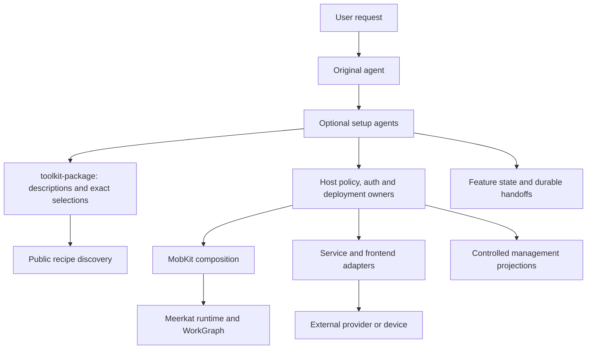

Connect's architecture separates description, selection, realization and actual use. It can grow an integration library without adding mandatory dependencies or policy to raw Meerkat.

## Description and selection

`toolkit-package` owns inert package/recipe types, imported metadata and exact manifest validation. `toolkit-mobkit::discovery` presents public evidence for agents. Neither chooses an integration, grants access or contacts a provider while listing descriptions.

Descriptions can be partial. Agents complete the concrete choice after investigating source and prerequisites. This avoids a hidden classification pipeline and lets a vague request, maintained recipe or custom extension follow the same conceptual path.

## Application lifecycle

`toolkit-catalog` contains the generated Connect acquisition lifecycle schema. Its name refers to the native DSL catalog, not a service marketplace. It records concrete work and typed observations; it does not interpret user intent or become an auth/runtime owner.

`meerkat-toolkit` composes request, setup, binding and continuation work through the native runtime and application APIs.

`toolkit-store` supplies an injected atomic persistence boundary for feature state and effects. WorkGraph and native runtime semantics remain responsible for their own work. Durable projections do not replace the canonical owners they observe.

## Execution and reuse

Python and TypeScript operations are independently consumable. They borrow selected host transports and expose explicit operation results. Frontend transports supply provider facts or one delivery attempt; the host composes admission, conversations and durable output.

The native MCP adapter realizes a selected remote service using the existing session/native execution surface. Native tools use Meerkat's existing bundle owner; Meta forwards and composes the accepted inputs. Connect does not start a second runtime to make integration code convenient.

## Presentation

The UI is a controlled view over authenticated host projections. It can validate presentation consistency and preserve control occurrences. It cannot infer grants, compute canonical readiness or turn a callback rejection into an owner outcome.

## Consumer boundaries

Applications supply their own tenant, device, audience and deployment policies while sharing the integration components.

The [role model](/connect/concepts/roles), [package contracts](/connect/reference/packages) and [continuation model](/connect/reference/continuation) describe the boundaries in more detail.
