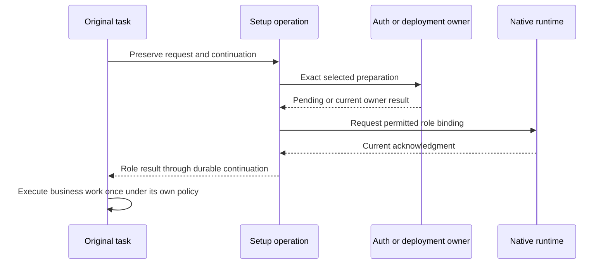

An application keeps the setup request, runtime continuation and external operation associated with their existing records. The following contracts describe how to compose those handoffs.

## Separate the records

| Record or observation | Owns |
| --- | --- |
| Acquisition | One original request, its required roles and per-request outcome |
| Shared preparation | Exact reusable auth/install preparation after concrete selection |
| Role intent and grant | Desired service access or frontend exposure and permitted scope |
| Runtime acknowledgment | Actual selected binding at a current revision/incarnation |
| Original task continuation | Where the admitted task resumes |
| Business invocation | The requested read/write/send and its effect outcome |
| Delivery record | An allowed output sent to an exact destination |

No generic work status replaces these owners. A ready-event replay cannot repeat the original email send.

## Durable handoffs

Persist the operation and effect intent before realizing effects. Commit owner state, events and handoffs through the selected atomic boundary. Use accepted WorkGraph/native semantics for runtime work rather than private parallel admission or custody protocols.

An awaiting caller can disappear after a successful commit. Recover using the same canonical operation and exact input identity before attempting another mutation. Readiness still needs current grants and runtime observations when the original task resumes.

## Coalescing without merging authority

Exact replay and host-authorized workflow grouping can avoid duplicate setup teams. Every distinct logical request still receives agent interpretation. After concrete package/subject/strategy selection, compatible requests can share one preparation.

Shared preparation does not merge requester, grant, role, target, audience, deadline or result destination. Cancelling one waiter releases its interest and prevents its uncommitted role activation while preserving callbacks needed by surviving waiters. The preparation owner's policy decides what happens when no waiters remain.

## Recovery cases

| Interruption | Recovery rule |
| --- | --- |
| Browser or UI closes | Observe the durable operation; UI lifetime does not cancel it |
| Auth callback arrives late | Revalidate the owning attempt and current cancellation/expiry state |
| Runtime member is restored | Resolve the current session from durable identity and reconcile bindings |
| Deployment wait expires | Report waiter expiry separately from rollout outcome |
| Send may have completed | Preserve unknown effect; reconcile before any permitted repeat |
| Provider accepted one multipart part | Retain each part's receipt and uncertainty independently |

A credential challenge must itself be durably owned or explicitly invalidated after restart. Persisting setup state alone does not preserve a process-local browser transaction. Person-bound ceremonies may prohibit replacement until domain reconciliation.

## Output delivery

Frontend transport receipt, durable admission, runtime acceptance, run completion and provider delivery are different facts. Revalidate current audience and exact destination before queued delivery. A delivery retry reuses its delivery record; it cannot create another agent invocation.

The current [Python egress owner](/connect/sdks/python-frontends#durable-egress) preserves uncertain output and only retries explicit known-not-sent outcomes under its bounded policy. General exactly-once external effects are not promised.
