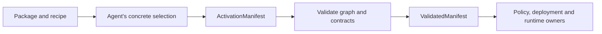

**Current metadata API.** `toolkit-package` separates a discoverable package description from a concrete activation selection. Neither layer executes integration code or grants authority.

## Inspect public metadata

The source-built `toolkit-package-inspect` command exposes the existing importers through bounded stdin/stdout:

```sh
toolkit-package-inspect agent-plugin < plugin.json
toolkit-package-inspect mcp-servers < mcp.json
toolkit-package-inspect mcpb < manifest.json
```

Input is limited to 1 MiB; the JSON report to 256 KiB. Exit 0 means parsed metadata, possibly with diagnostics; exit 2 means refusal and exit 1 means output failure. Check diagnostics and accepted-server counts. Invalid MCP siblings are skipped, and arbitrary client configuration formats are not guessed.

Reports omit executable/configuration values and include the exact input digest, roles or configuration field names where available. Names and diagnostic scopes remain untrusted public source text. The tool does not open package files, execute commands or establish readiness. Separate artifact distribution is unfinished; the command is currently part of the `toolkit-package` source crate.

## Package description

`IntegrationPackage` contains:

| Field | Meaning |
| --- | --- |
| `schema_version` | Description schema version |
| `identity` | Exact `publisher`, `name`, `version` |
| `display_name`, `description` | Human/agent investigation material |
| `provenance` | Source, source revision, license, notices and local patch digests |
| `strategies` | Explicit setup alternatives and unresolved details |
| `known_exports` | Service/frontend hints; not an activation declaration |
| `assessments` | Scoped support claims with evidence references and observation time |

Current `StrategyKind` values are `remote_mcp`, `local_mcp`, `native_adapter`, `configuration_recipe` and `research_skill`. An acquisition form such as a CLI pack is a composition choice, not an invented additional enum value.

## Activation selection

`ActivationManifest` names exact package identity/content digest, strategy, configuration and policy references, components, exports, required contracts, host services and optional portable MCP entries.



Validation constructs `ValidatedManifest`, including a canonical payload digest and dependency order. Deserialization alone cannot create that validated value. Host compatibility checks report required gaps and explicit optional degradation before code is imported.

## Components

A `Component` names its ID/version, source, runtime, placement, lifetime, activation scope, dependencies, host contracts, state, readiness, shutdown and rollback.

| Source | Required identity |
| --- | --- |
| Artifact | Location, content digest, entrypoint and self-contained/locked/pinned dependency declaration |
| Remote service | Endpoint, publisher, configuration revision, observed contract and transport |
| Host-provided service | Exact declared host service requirement |

A remote endpoint identifies an observed service contract; it does not pretend to pin immutable implementation bytes. Entrypoint arguments are literal argv, not shell expressions.

Selected components must be reachable from selected exports. Dependencies need matching selected versions and an acyclic graph. Request-lifetime components cannot support persistent frontend/daemon dependencies.

## Role exports

Service exports declare operations or events, authentication, enforcement, diagnostics and cleanup. Operations include schema digest, declared effect, resource contract and result limits. Package-declared read/write labels are untrusted inputs to the policy owner, not permission decisions.

Frontend exports declare modalities and admission, conversation, delivery and optional control/live contracts. A voice contract requirement is not a live-session receipt. Both roles can reference shared components while retaining independent activation and removal.

## State, shutdown and rollback

State contracts identify namespace, owner, format and owner-bound migrations from accepted prior formats. Each migration names its operation/artifact and whether it is reversible. `state_changes_from` reports obligations without performing them.

Shutdown declares the owner, operation, maximum wait and whether timeout preserves uncertainty or uses owner-controlled fencing. Rollback is explicitly reversible, irreversible with explanation, or owner reconciliation. A metadata timeout cannot itself kill a process or prove an external effect ended.

Exact structs are in `crates/toolkit-package/src/model.rs` and `manifest.rs`. [Deployment](/connect/reference/deployment) explains how owners realize this logical model.
