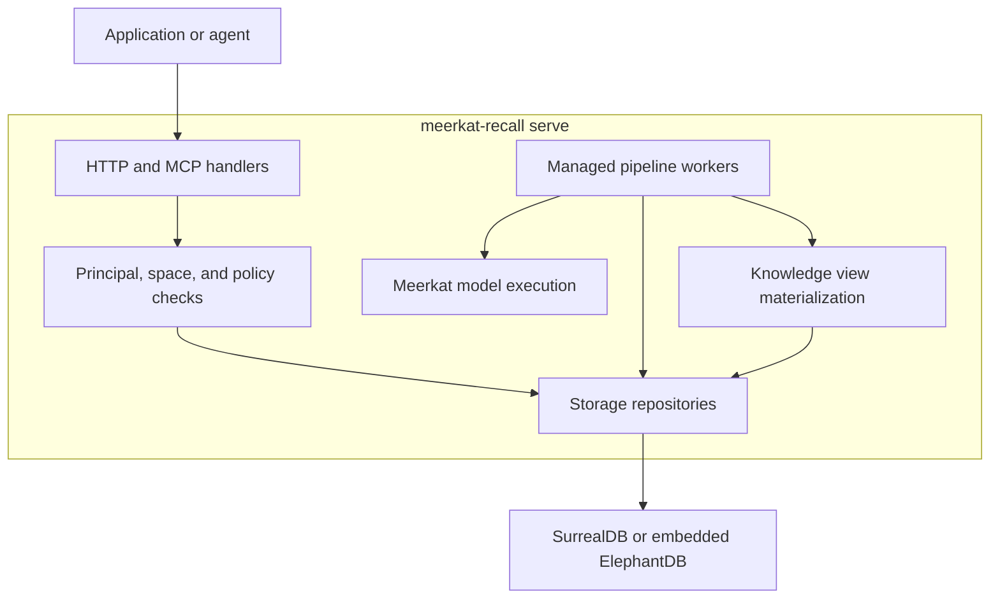

Meerkat Recall has two related responsibilities: serve authorized knowledge reads and
writes, and process evidence into derived knowledge. The public `elephant`
command assembles these into a managed runtime.

## Default runtime

`meerkat-recall serve` runs HTTP, MCP, and managed workers in one process. Workers and
request handlers share the configured storage backend.

The API accepts an ingest and records work. Workers then render evidence, plan
extraction, validate and commit artifacts, and process truth-maintenance events.
The [pipeline overview](/recall/pipeline/overview) describes that sequence; the
[domain model](/recall/architecture/domain-model) describes the records it produces.

## Boundaries that matter

| Boundary | Responsibility | Consequence for callers |
| --- | --- | --- |
| Authentication and policy | Resolve a principal, enforce space isolation, scopes, clearances, and redaction | A record's existence does not imply that every caller can retrieve it |
| API and MCP | Validate requests and expose operations through distinct protocols | Use each surface's request and response contract |
| Pipeline | Lease work, stage outputs, validate artifacts, commit results, and schedule dependent work | Ingest acceptance and processing completion are separate observations |
| Model execution | Use Meerkat for extraction, truth adjudication, and wiki editorial calls | Model readiness and credentials are part of semantic ingest readiness |
| Storage repositories | Provide the application's typed storage contract over the selected backend | Backend capabilities and persistence still differ |
| Knowledge views | Build derived, cited projections and track their freshness | A view is a projection of authorized evidence, not a new source of evidence |

Meerkat provides model execution. Meerkat Recall owns the knowledge schema, policies,
pipeline scheduling, artifact validation, and storage. The MCP server uses the
Rust `rmcp` transport. See [MCP profiles](/recall/mcp/overview) for the tool surface;
tool visibility also depends on runtime readiness and authorization.

## Choose a process and storage layout

| Layout | How it runs | Operational boundary |
| --- | --- | --- |
| Managed server with SurrealDB | `meerkat-recall serve` plus a persistent SurrealDB backend | Default Compose layout; apply migrations before serving |
| Managed embedded server | `meerkat-recall serve` with `ELEPHANT_DB=elephant-db` | API and workers share one store; a configured persistent destination synchronizes acknowledged commits to its WAL |
| Separate worker with SurrealDB | `meerkat-recall serve --server-only` and `meerkat-recall worker` against the same database | Advanced configuration; check readiness and coordinate schema and worker configuration |

`meerkat-recall worker` rejects the embedded ElephantDB backend: a separate process
would own a different in-memory store. The supplied configuration does not
establish a tested multi-node scaling or high-availability contract. Treat
such a topology as deployment work requiring its own acceptance tests.

Managed embedded storage with a persistent destination synchronizes acknowledged
mutations to a write-ahead log and replays it before startup admission. Shutdown
snapshot export is not the commit durability boundary. Explicitly ephemeral
library/test stores without a persistent destination remain volatile. See
[managed embedded commit durability](https://github.com/lukacf/meerkat-recall/blob/13be7b1a1c4a9bb5fcf8c46d1a7ce1c3137fdfd3/docs/embedded-durable-commits.md),
[deployment](/recall/operations/deployment) and the [CLI reference](/recall/cli/overview).

## Find the implementation

The workspace separates domain contracts from runtime assembly. Start with the
smallest owner of the behavior you need to change.

| Area | Location | Owns |
| --- | --- | --- |
| Public command | `bin/elephant` | Server, worker, status, snapshot, migration, and demo commands |
| Server assembly | `bin/elephant-api` | Axum routes, authentication, MCP transport, runtime configuration |
| Worker assembly | `bin/elephant-pipeline` | Worker registration and execution environment |
| Domain | `crates/types` | Records, IDs, request/response types, validation |
| Storage | `crates/storage`, `crates/elephant-db`, `crates/migrations` | Repositories, embedded kernel, SurrealDB schema |
| Authorization | `crates/policy` | ABAC decisions, subject restrictions, redaction |
| Identity | `crates/identity` | Identity keys and entity merge behavior |
| Processing | `crates/pipeline`, `crates/outbox`, `crates/embeddings` | Evidence processing, change events, vector providers |
| Agent tools | `crates/mcp` | Tool schemas, profiles, handlers |
| Derived views | `crates/knowledge-views` | Context projections, materialization, citation and freshness behavior |
| Library entry point | `crates/elephant` | Rust library API |

For contribution setup and checks, use [development](/recall/operations/development).
For database boundary invariants, use [SurrealDB patterns](/recall/operations/surrealdb-patterns).
For the projection architecture, use [Living Wiki](/recall/architecture/living-wiki).
