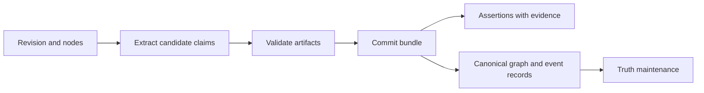

An assertion records a claim extracted from a document and the evidence span
that supports it. In "Mara joined Northstar Labs in March 2026," an assertion
can preserve the subject mention `Mara`, the raw predicate, and the object
mention `Northstar Labs` before and after they are mapped to canonical records.

An assertion answers **what did this source say?** A
[truth slot](/recall/concepts/truth-maintenance) answers **which supported values are
current?** Keeping both lets you inspect a disagreement without losing either
source's claim.

## From extraction to committed evidence

The active graph-ingestion path stages model output as `knowledge_candidates`
artifacts. Validation prepares a typed commit bundle, and `commit_artifacts`
writes assertions and the corresponding graph or event records. Entity
resolution and promotion participate in that boundary.

A successful extraction work item is not, on its own, proof that canonical
records were committed. Use [document pipeline status](/recall/api/documents#get-document-pipeline-status)
to follow the artifact and work-item stages. The former separate
`resolve_assertions` worker is outside the active path.

## Read the parts of a claim

| Field | Meaning |
|-------|---------|
| `subject_text` | The subject mention extracted from the source |
| `predicate_raw` | The source or extractor's predicate wording |
| `predicate_id` | Canonical predicate, when known |
| `object_text` | An entity mention on the object side |
| `object_literal` | A literal-valued object such as a number or date |
| `subject_entity`, `object_entity` | Resolved entity references, when applicable |
| `confidence` | Extraction confidence |
| `resolution_confidence` | Confidence in mapping mentions to entities |

Current inline promotion copies the extraction score into
`resolution_confidence`; it is not an independently calibrated identity score.
A literal claim does not need an object entity. A resolved assertion also does
not imply that its derived relationship is approved or that its value won a
conflict.

## Follow evidence to immutable text

Every assertion has an `EvidenceSpan`:

| Field | Meaning |
|-------|---------|
| `revision` | The immutable document revision containing the evidence |
| `node` | Optional structural node associated with the span |
| `start`, `end` | Byte offsets into that revision's UTF-8 text |
| `quote_hash` | Integrity hash used to check the referenced passage |

Read the cited revision, slice the recorded byte range, and verify its hash
when interpreting evidence. Do not apply old offsets to a document's newest
text: a later render can change the text and offsets while the original
revision remains the evidence authority. Byte offsets also differ from
character positions for non-ASCII text.

Media-backed revisions can additionally map those spans to attachments and
time ranges through their render manifest. See [documents](/recall/concepts/documents).

## Distinguish the three timestamps

| Timestamp | Question | Example |
|-----------|----------|---------|
| `source_event_time` | When did the described occurrence happen, if known? | A joining date in March |
| `observed_at` | When did Meerkat Recall observe the source? | The note was ingested in April |
| `asserted_at` | When was the claim extracted? | The extraction ran later in April |

A recently ingested source can describe an old event. These fields distinguish
the intended temporal meanings. Current inline promotion initializes
`observed_at` and `asserted_at` to the promotion time, so those two fields alone
do not reconstruct a delayed source's original arrival time. Inspect source
metadata and the evidence timestamps when that distinction matters.

## Resolution and retention state

The record type supports the following resolution states:

| State | Meaning |
|-------|---------|
| `pending` | No recorded resolution outcome |
| `resolved` | Required entity references were resolved |
| `partial` | Only part of the mapping is known |
| `abstained` | Resolution declined an ambiguous or low-confidence mapping |
| `failed` | Resolution recorded failure |
| `superseded` | Replaced during reprocessing |

The active inline promotion path writes resolved assertions. These states are
record semantics, not a promise that each assertion passes through six
separate worker stages. Retry failures are inspected through the active
[work queue](/recall/pipeline/work-queue).

`assertion_key` makes repeated promotion of the same node and claim
idempotent. Its current construction includes the document-node ID, raw
predicate, and a hash of the subject and object. A new revision with different
nodes can therefore produce new assertion IDs; deduplication is not a promise
that every paraphrase or re-render collapses into one record.

Assertions also carry `lifecycle_tier`. The `active` tier is used by normal
processing; archival can retain older resolved evidence for provenance while
excluding it from normal active queries. The record's tier is distinct from
its resolution state and from a work item's status.

## Next steps

- [Assertions API](/recall/api/assertions) lists, searches, and retrieves evidence records.
- [Relationships](/recall/concepts/relationships) explains the claims derived from them.
- [Truth maintenance](/recall/concepts/truth-maintenance) explains corroboration and conflict.
