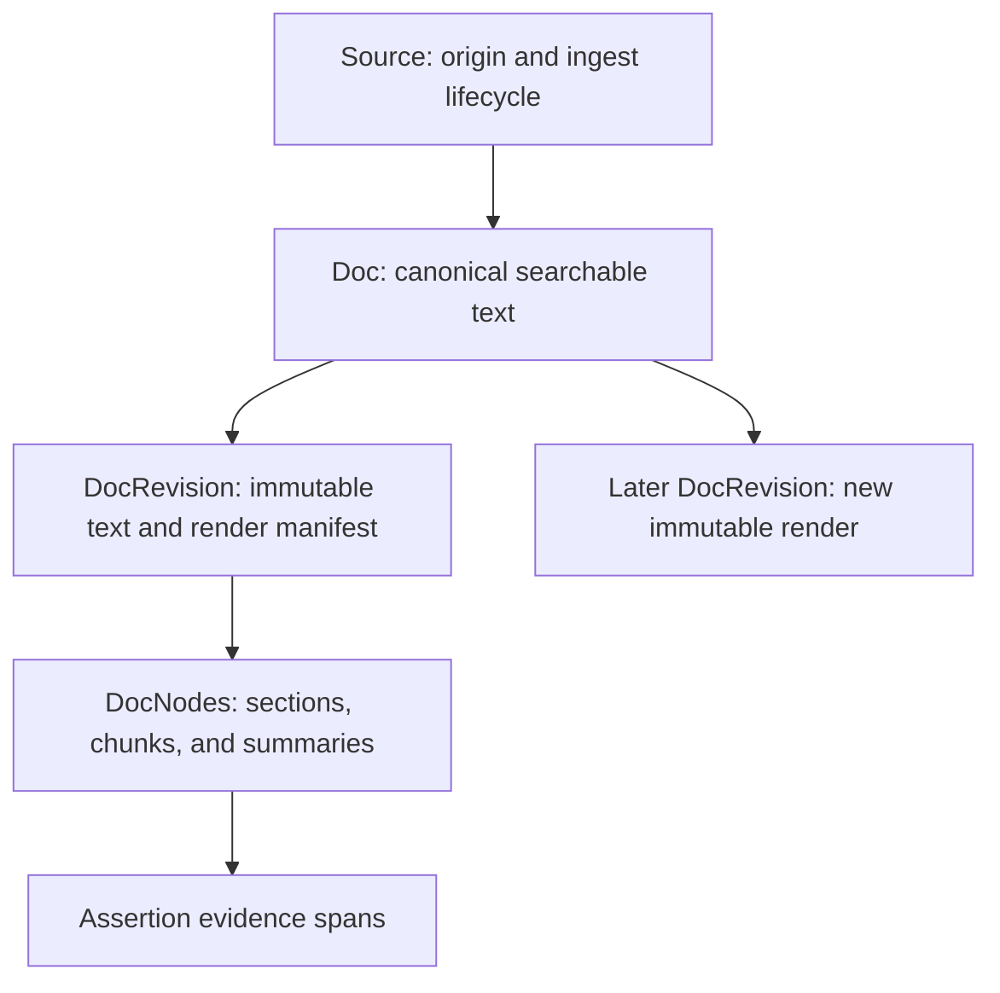

Source-first ingestion begins with where content came from. A `Source` records
its origin and processing state; a `Doc` carries a searchable text projection;
immutable `DocRevision` records preserve the text that evidence cites.
`DocNode` records provide structure and retrieval units within a revision.

For a project note, those layers mean: its origin, its current rendered text,
the exact text an extraction saw, and the chunks a search can return.

## Four records, four responsibilities

| Record | Owns | Use it for |
|--------|------|------------|
| `Source` | Origin, external references, source type, ingest decision and lifecycle | Determining what was received and how deeply it has been processed |
| `Doc` | Title, current canonical `text`, source link, attachment inventory, metadata | Document search and the current document view |
| `DocRevision` | Immutable rendered text, text hash, renderer metadata, optional media manifest | Reconstructing and verifying cited evidence |
| `DocNode` | Revision-relative spans, parent/child structure, role, optional generated text | Chunk retrieval, extraction inputs, and embeddings |

The document convenience APIs create a manual source for you. They enter the
same source-first pipeline. The optional source link in the record type also
supports older data; it does not define a second preferred ingest lifecycle.

## Choose processing depth

| Ingest mode | Intended result |
|-------------|-----------------|
| `skip` | Record the decision to skip further processing |
| `metadata` | Normalize and retain source metadata and external references |
| `retrieval` | Add rendered evidence and retrieval structure, with embedding work |
| `graph` | Continue through extraction, validation, and graph/event commit |

A requested mode and a completed mode are different. Source triage, readiness,
and configured budgets can affect the accepted decision. Read
`latest_ingest_decision`, `current_ingest_mode`, and `lifecycle_status` rather
than inferring completion from the request you sent.

The lifecycle records `discovered`, `triaged`, `metadata_ready`,
`retrieval_ready`, and `graph_ready`, with `skipped` and `rejected` outcomes.
Embedding and downstream maintenance run asynchronously. A source reaching a
lifecycle milestone does not guarantee every derived view has already refreshed.

## Rendering and revisions

Rendering normalizes the input into canonical text. A revision records the
renderer name, version, and configuration hash together with `text_hash`.
Re-rendering creates a new revision and can supersede the old one.

An assertion's offsets belong to its cited revision, even after the document's
current text changes. This is what allows old claims to retain verifiable
provenance. Use revision text for evidence and the document's current `text`
for current search behavior.

### Images and video

Media attachments remain attached to source/document lineage. The revision's
render manifest maps rendered text spans back to attachments and time ranges.
The parent document's attachment list is ingest inventory; the revision
manifest is the authority for the provenance of a particular extraction.

`Doc.text` is the canonical searchable projection for text and media-backed
documents. Caller-provided `sidecar_text` and attachment metadata supplement
that projection. Applications should not build a second competing search
index over an incidental attachment field.

## Nodes and collections

Nodes can represent documents, sections, paragraphs, spans, chunks, summaries,
lists, tables, and table cells. Their `span.start` and `span.end` are byte
offsets into revision text. A generated summary can have its own `text` field.

Chunk nodes are the usual embedding and retrieval unit. Their
`embedding_model` and `collection` fields record indexing context. Documents
can use `metadata.collection` for logical groupings such as `project-notes`
or `research`.

A collection helps select content within a space. It is not an authorization
boundary: [security](/recall/concepts/security) is evaluated separately.

## Interpret ingestion results

A source or document ID acknowledges a stored intake record. Follow the
[work queue](/recall/pipeline/work-queue) and
[document pipeline status](/recall/api/documents#get-document-pipeline-status) to see
what completed, failed, or remains queued.

| Observation | What to inspect next |
|-------------|----------------------|
| Source exists, no document chunks | Ingest decision, render and document-tree work |
| Document can be read, semantic search is weak or empty | Embedding configuration and node embedding progress |
| Chunks exist, no graph claims | Requested depth, extractor readiness, candidate artifacts, validation and commit |
| Claims exist, current answer or article is stale | Truth maintenance and derived-view status |

Idempotency also operates at several levels. Sources use content and origin
information; documents have `rendition_key`; extraction promotion uses
assertion keys. Reusing an ID or key does not mean that arbitrary changed
content will be interpreted as the same immutable evidence.

## Next steps

- [Ingesting data](/recall/guides/ingesting-data) provides runnable workflows.
- [Document API](/recall/api/documents) and [source API](/recall/api/sources) define exact payloads.
- [Assertions](/recall/concepts/assertions) explains how claims cite revisions.
- [Extraction](/recall/pipeline/extraction) covers skills and the artifact commit boundary.
