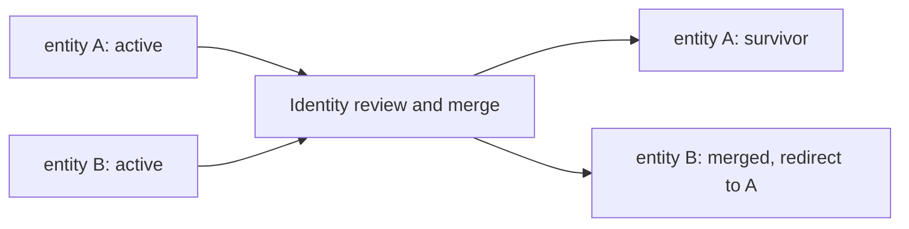

An entity is an identifiable person, organization, place, or domain concept.
Its record ID connects evidence across documents even when the wording changes.
In the [running example](/recall/concepts/overview), Mara and Northstar Labs are two
entities; `works_at` is the relationship between them.

## Choose an entity or a literal

Use an entity when the thing needs its own identity, can appear in several
sources, or needs relationships of its own. Use an
[attribute](/recall/concepts/relationships#attributes) for a value such as a title,
number, or date.

| Model | Example | Why |
|-------|---------|-----|
| Entity | Northstar Labs | Other people, projects, and locations can connect to the same organization |
| Attribute value | `"Research engineer"` | A role label can be a literal on Mara |
| Event | Mara joining Northstar Labs | The occurrence has its own time and evidence |

A display name is a label. Two records named "Mara" are not necessarily the
same person, and renaming a record does not change its ID.

## Types describe your domain

Entity types are freeform strings. The type constructor normalizes them to
lowercase. Common conventions include `person`, `org`, `location`, `topic`,
`device`, `platform`, `concept`, and `group`; a technical corpus can use
`component` or `data_model`.

Choose a consistent vocabulary in your extraction skill. Types affect entity
reuse during promotion, so using `person` for a software component can have
consequences beyond display formatting. The `topic` type acts as an unknown
bucket in the promotion compatibility check and can be refined when a more
specific type becomes known.

## Names, handles, and identity keys

| Field | Purpose | Example |
|-------|---------|---------|
| `display_name` | Primary label shown to readers | `Mara` |
| `aliases` | Alternative names for the same entity | `M. Vale` |
| `handles` | Platform and username pairs, with optional evidence and confidence | A synthetic `github` handle |
| `identity_keys` | Cached keys used by identity resolution | A normalized identifier supplied through the identity workflow |
| `summary` | A short description | A brief contextual description of the person |
| `metadata` | Application-specific JSON | Tags or external mapping information |

Aliases help retrieval; they do not establish identity on their own. The
identity-key index and the promotion resolver decide reuse. The resolver
checks all matching keys and type compatibility before selecting an existing
entity.

When compatible matches remain ambiguous, a configured disambiguator can
choose among them. Without that disambiguator, the current fallback reuses the
earliest compatible match with a warning. Incompatible types produce a new
entity. Applications that require explicit identity review should inspect
identity candidates rather than treating name similarity as a merge decision.

## Merging duplicates

An entity starts with `status: active`. A merge keeps a surviving entity and
marks the other `merged`, with `redirect_to` pointing to the survivor. This
preserves a way to understand references to the old identity.

Use the supported [identity merge operation](/recall/api/system#identity-resolution)
so dependent graph references are handled by the merge workflow. Editing a
name or setting a status field manually does not perform that workflow.

## Read an entity in context

A bare entity record answers identity and descriptive questions. To explain a
claim, follow its relationships, attributes, truth slots, and source evidence.
The MCP [`get_entity_context_bundle`](/recall/mcp/tools#get_entity_context_bundle)
operation collects authorized context; [`get_entity_with_relations`](/recall/mcp/tools#get_entity_with_relations)
provides the entity with its graph connections.

The returned context depends on the caller's space, scopes, clearances, and
subject allowlist. The same entity ID does not imply identical visible
context for every principal.

## Next steps

- [Relationships and attributes](/recall/concepts/relationships) explain claim shape,
  status, and validity.
- [Building graphs](/recall/guides/building-graphs) shows how to create connected records.
- [Entity API](/recall/api/entities) documents request and response fields.
