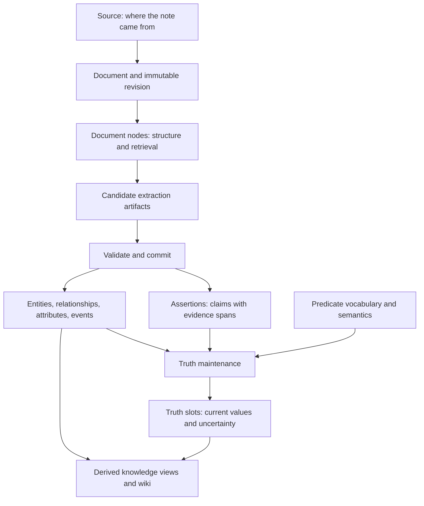

Meerkat Recall connects claims to the evidence that supports them. It keeps the
original source, the extracted interpretation, and the current answer as
separate records so that a reader can ask both **what do we know?** and **why do
we believe it?**

Consider a synthetic project note: "Mara joined Northstar Labs in March 2026."
That sentence can support an employment relationship and a dated event. It
does not, by itself, prove that Mara still works there today.

## From evidence to an answer

The diagram shows the graph-ingestion path. A source can also stop after
metadata processing or document retrieval. Background work is asynchronous:
accepting an ingest request does not mean its graph or wiki page is ready.

## What each record means

| Concept | In the project-note example | Question it answers |
|---------|-----------------------------|---------------------|
| [Source and document](/recall/concepts/documents) | The note, its origin, and an immutable rendered revision | Where did the evidence come from? |
| [Assertion](/recall/concepts/assertions) | The extracted claim that Mara works at Northstar Labs, with a span into that revision | What did this source say? |
| [Entity](/recall/concepts/entities) | Mara and Northstar Labs, each with a stable record ID | Which people or things are involved? |
| [Relationship or attribute](/recall/concepts/relationships) | `Mara works_at Northstar Labs`; a separate literal-valued claim such as a role | What claim connects these records? |
| [Event](/recall/concepts/events) | Mara joining in March, with month-level time precision | What happened, and when? |
| [Predicate](/recall/concepts/predicates) | The meaning of `works_at`, its aliases, and whether multiple employers can coexist | How should this kind of claim behave? |
| [Truth slot](/recall/concepts/truth-maintenance) | The supported current employment value or competing values | What answer should a reader use now? |
| [Living Wiki](/recall/architecture/living-wiki) | A derived article citing the supported graph and source evidence | How can a person read the knowledge coherently? |

Extraction is interpretive. The table illustrates possible records, rather
than promising an exact number of rows or identical model output on every run.

## Identity, evidence, and truth are different decisions

Three questions arise when another note says "Mara now works at Cedar Works":

1. **Identity:** is this the same Mara? Entity resolution uses names, identity
   keys, type compatibility, and, when configured, disambiguation.
2. **Vocabulary:** does "works at" mean the canonical `works_at` predicate?
   Predicate registration and alias governance answer that question.
3. **Truth:** did Mara change jobs, hold two roles, or appear in an ambiguous
   source? Truth maintenance evaluates the competing claim values and their
   configured semantics.

A high extraction confidence addresses what the source says. It does not
settle identity or prove that the statement remains true.

## Isolation and visibility

Records belong to a [space](/recall/concepts/spaces). Within that space,
[security envelopes](/recall/concepts/security) determine which records a principal
can read or modify. Truth maintenance and knowledge views also preserve
security boundaries: evidence from a more restricted envelope cannot silently
become a less restricted answer.

A missing search result can therefore mean that a record is unauthorized,
not yet processed, excluded by a status filter, or absent. Inspect the relevant
status and use the same principal and space when diagnosing it.

## Choose your next page

<CardGroup cols={2}>
  <Card title="Understand ingestion" icon="file-lines" href="/recall/concepts/documents">
    Start with sources, revisions, and the processing depth you need.
  </Card>
  <Card title="Model a graph" icon="circle-nodes" href="/recall/concepts/entities">
    Choose entity identities, predicates, and claim shapes.
  </Card>
  <Card title="Interpret an answer" icon="scale-balanced" href="/recall/concepts/truth-maintenance">
    Follow evidence, conflicts, validity, and staleness.
  </Card>
  <Card title="Control access" icon="shield-halved" href="/recall/concepts/security">
    Understand spaces, clearances, subjects, and derived reads.
  </Card>
</CardGroup>

For a runnable starting point, use the [quickstart](/recall/quickstart). For exact
request bodies, use the [HTTP API](/recall/api/overview) or [MCP tools](/recall/mcp/tools).
