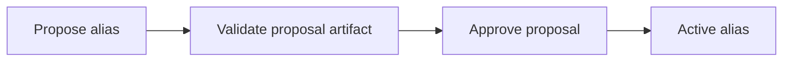

A predicate names what a claim means. In `Mara works_at Northstar Labs`, the
predicate is `works_at`. Relationships use it as `rel_type`; attributes use it
as `attr_type`.

The registry gives a space a canonical vocabulary. Its aliases connect source
wording such as "employed by" to that vocabulary. Its semantics describe how
claims behave over time and whether multiple values can be valid together.

## Vocabulary and semantics are separate

| Decision | Example | Owner |
|----------|---------|-------|
| Canonical meaning | Use `works_at` for an employment relationship | Predicate registry |
| Alternate wording | Map "employed by" to `works_at` | Alias governance |
| Allowed values | A person may have several concurrent employers | Predicate semantics |
| Current answer | Select or retain the values supported by the evidence | Truth maintenance |

Registering a predicate does not settle its semantics. The MCP
[`register_predicate`](/recall/mcp/tools#register_predicate) operation stores an active
registry entry with `semantics: null` and `semantics_status: default`.
For example, its arguments can be:

```json
{
  "predicate_id": "works_at",
  "description": "The subject works for the object organization"
}
```

The tool registers vocabulary. The current public HTTP and MCP registration
surfaces do not accept an arbitrary semantics object or expose a general
semantics-update operation. Explicit operator configuration requires a
controlled administrative integration with the registry. The REST create
handler retains one special case for the exact predicate `has title`; do not
assume that behavior applies to arbitrary predicates or to MCP registration.

## Choose semantics from the domain

The meaning of a predicate determines whether two values contradict each
other. Two languages a person speaks can coexist. Two different values for a
single-valued identifier need examination. Employment may permit concurrent
roles, so `works_at` should not automatically be configured as single-valued
for every application.

| Setting | Question |
|---------|----------|
| `cardinality` | Is one value or more than one value allowed? |
| `temporal_model` | Is this a changing state, an occurrence, or another temporal pattern? |
| `conflict_policy` | How should the deterministic fallback handle disagreement? |
| `recency_basis` and `fallback_order` | Which timestamp represents recency when some dates are missing? |
| `min_evidence` and `promotion_threshold` | What support and confidence are needed? |
| `source_priority` | Are some evidence sources preferred? |
| `alias_thresholds` | Which aliases are trusted for truth or query expansion? |

The default semantics object permits many values with `allow_parallel` and a
promotion threshold of `0.7`. An absent semantics object still means the
predicate is unconfigured. In particular, truth maintenance examines unknown
cardinality for possible cross-object conflicts rather than assuming it has
been deliberately configured as `many`.

## Review status records who supplied the policy

| `semantics_status` | Meaning |
|--------------------|---------|
| `configured` | Explicitly configured by an operator |
| `default` | Defaults or no reviewed semantics |
| `needs_review` | Flagged for review |
| `llm_proposed` | Proposed during truth-maintenance adjudication |

When a real conflict has unknown semantics, the configured LLM adjudicator can
propose them. A proposal cannot overwrite operator-configured semantics.
Later adjudications can revise non-configured proposals. Registry changes
emit an outbox event so dependent truth slots can recompute.

An LLM proposal is useful evidence for review, rather than equivalent to
operator configuration. The Living Wiki's governed graph context requires
explicitly configured predicate semantics before those graph claims can
contribute to an article.

## Govern aliases

An alias record maps a raw string, plugin code, or schema field to a canonical
predicate. Its status can be `proposed`, `active`, or `deprecated`.



The pipeline proposal workflow stages a `work_artifact`. The MCP tools
[`validate_predicate_proposal`](/recall/mcp/tools#validate_predicate_proposal) and
[`approve_predicate_proposal`](/recall/mcp/tools#approve_predicate_proposal) consume
that artifact's ID; an unvalidated artifact cannot be approved.

The similarly named
[`propose_predicate_alias`](/recall/mcp/tools#propose_predicate_alias) tool creates a
`PredicateAlias` row with status `proposed`. Its returned alias ID is not a
proposal artifact ID and cannot be passed to the artifact validation tools.
The [HTTP alias status operation](/recall/api/predicates#update-alias-status) is the
separate surface for activating or deprecating an alias row.

Aliases also have scopes:

| Scope | Applies within |
|-------|----------------|
| `global` | The space's general predicate vocabulary |
| `plugin_only` | The specified plugin context |
| `source_type` | The specified source-type context |

Here `global` does not grant cross-space access. Record space and security
checks continue to apply.

Alias thresholds distinguish weak query assistance from canonical truth. The
default `query_expand_min_confidence` is `0.6`; the default
`truth_min_confidence` is `0.9`. A useful search synonym is not automatically
strong enough to rewrite a canonical claim.

## Avoid semantic surprises

- Review cardinality before interpreting every different object as a conflict.
- Keep raw wording in assertions so a canonicalization decision remains auditable.
- Treat a semantics update as a change that can make existing truth slots stale.
- Do not infer operator approval from an active registry entry or an LLM proposal.

## Next steps

- [Predicate API](/recall/api/predicates) documents registry reads and alias operations.
- [Truth maintenance](/recall/concepts/truth-maintenance) explains how semantics affect answers.
- [Assertions](/recall/concepts/assertions) preserves the original predicate wording.
