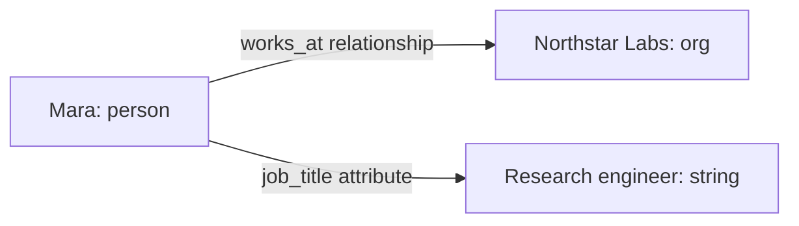

A relationship connects two entities. An attribute connects an entity to a
literal value. Both are claims with a predicate, status, confidence, evidence,
and an optional validity window.

In the [running example](/recall/concepts/overview):



Use the relationship when the object has an identity of its own. Use the
attribute when the object is a value you want to read or compare.

## Relationships

The canonical entity-to-entity record is named `Rel` in Rust and `rel` in
storage. Its essential fields are `subject`, `object`, and `rel_type`.

A relationship is directed: `Mara works_at Northstar Labs` does not mean
`Northstar Labs works_at Mara`. Query incoming edges when starting from the
organization, or outgoing edges when starting from the person. Do not create
an inverse claim merely to support reverse traversal.

`rel_type` holds the canonical [predicate](/recall/concepts/predicates). Predicate
semantics determine whether two objects can coexist and how temporal changes
should be handled.

## Attributes

An `Attribute` uses `subject`, `attr_type`, and a typed `value`. The serialized
value has a type tag:

```json
{ "type": "string", "value": "Research engineer" }
```

| Literal tag | Value shape | Example |
|-------------|-------------|---------|
| `string` | String | `"Research engineer"` |
| `integer` | Integer | `42` |
| `float` | Number | `3.14` |
| `boolean` | Boolean | `true` |
| `date` | ISO 8601 date string | `"2026-03-01"` |
| `date_time` | ISO 8601 timestamp string | `"2026-03-01T09:00:00Z"` |
| `duration` | ISO 8601 duration string | `"P1Y"` |
| `json` | JSON value | `{"category": "research"}` |

The serialized `DateTime` variant uses `date_time`. A date-shaped string tagged
`string` remains a string claim; it does not gain date semantics from its
appearance.

## A committed claim can still be a candidate

Artifact commit persists canonical graph records. Truth maintenance then
evaluates supported claims for current answers. These are separate milestones.

| Status | Interpretation |
|--------|----------------|
| `candidate` | Persisted claim awaiting validation as a current answer |
| `approved` | Accepted claim under the applicable truth decision |
| `superseded` | Replaced by another claim |
| `disputed` | Conflict remains to be resolved |

Extraction promotion creates candidate relationships and attributes. Do not
interpret a successful ingest response, a stored row, or a high confidence
score as equivalent to an approved current answer. Read the relevant
[truth slot](/recall/concepts/truth-maintenance) when your application needs that answer.

## Validity windows

A validity window describes when the claim applies in the world. It is
separate from when Meerkat Recall stored the row.

| `start` | `end` | Interpretation |
|---------|-------|----------------|
| Absent | Absent | No known bounds |
| Present | Absent | Known start, no recorded end |
| Present | Present | Bounded interval |
| Absent | Present | Known end, unknown start |

The interval includes its start and excludes its end. For example, a claim
ending at `2026-06-01T00:00:00Z` no longer applies at that instant. An absent end
means no end is recorded; it is not independent proof that the claim is still
true today.

Truth maintenance can close a superseded claim's window. Corroborating a claim
with another source adds support without inventing an end date.

## Evidence and confidence

`evidence` is a list of `EvidenceRef` values, each pointing to an assertion
and an immutable source span. The reference also stores the `time_basis` and
`time_value` used for recency: source event time, observation time, or assertion
time.

Several documents can support the same value. Truth maintenance can merge
that evidence into one winning claim. A competing value remains inspectable
through the conflict and its evidence, even when another value is selected.

Direct graph-write surfaces can create records without extracted document
spans. If your application needs documentary provenance, ingest the source or
supply real evidence through the supported contract; do not manufacture a
citation for a manual claim.

## Next steps

- [Building graphs](/recall/guides/building-graphs) shows the write workflow.
- [Relationships API](/recall/api/relationships) documents relationship operations.
- [Truth slots guide](/recall/guides/truth-slots) shows how to read current answers.
