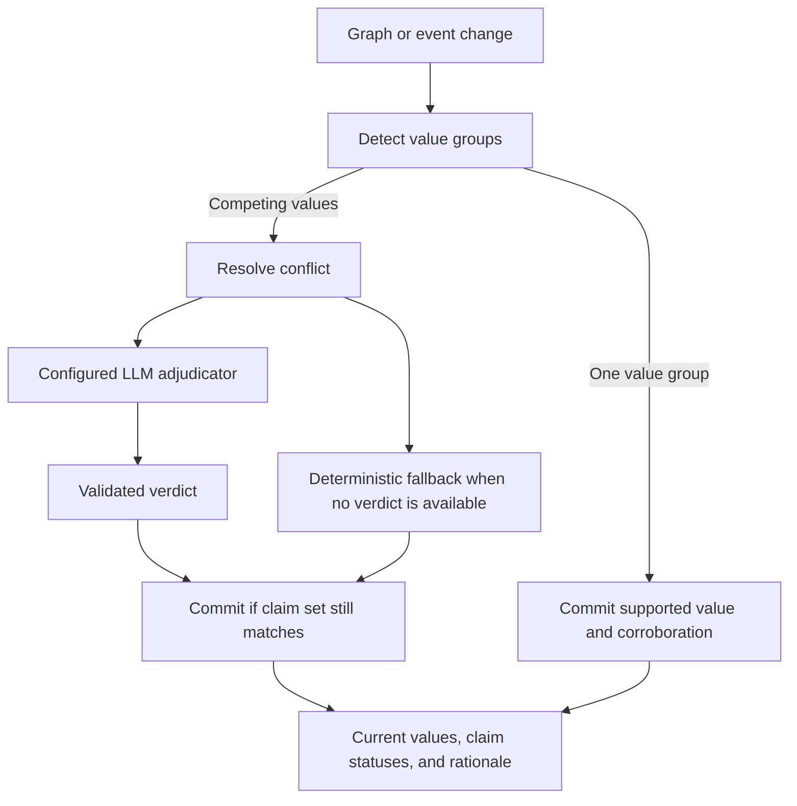

Truth maintenance evaluates committed claims and maintains the current answer
for a subject and predicate. The answer can be one value, several coexisting
values, or unresolved uncertainty. The system records the evidence and
rationale so a reader can inspect how it reached that answer.

Suppose one note says Mara works at Northstar Labs and another says she works
at Cedar Works. Those claims might describe a job change, concurrent roles,
or a mistaken identity. Their ingest order alone does not decide which
interpretation is correct.

## Corroboration and conflict

Detection first groups claims by exact value equality.

| Evidence | Interpretation | Processing |
|----------|----------------|------------|
| Two sources name the same employer entity | Corroboration | Merge supporting evidence into a winner |
| Two sources name different employer entities | Possible disagreement | Examine predicate cardinality and the competing values |
| Different spellings represent the same value | Possible equivalence | A configured adjudicator can identify the equivalence |

Corroborating duplicates merge their evidence, deduplicated by assertion and
span, and are soft-deleted as duplicate claim rows. Their validity windows
are not closed: another source agreeing with a claim does not mean the claim
stopped being true.

For relationships, the ordinary slot includes both endpoints. A `rel_set`
slot additionally compares the different objects for one subject and
predicate. That cross-object check is used when cardinality is `one` or
unknown. A predicate explicitly allowing `many` values, or an event-like
predicate, does not create that form of cross-object conflict.

## Truth slots are materialized answers

A `TruthSlot` contains the current values and the metadata needed to interpret
them:

| Field | What a reader should use it for |
|-------|--------------------------------|
| `current_values` | Claim IDs, confidence, status, and supporting evidence |
| `conflict_group` | The linked conflict record, when present |
| `rationale` | Explanation of the recorded decision |
| `computed_at` | When this answer was computed |
| `stale`, `stale_reason` | Whether recomputation is required and why |
| `semantics_version`, `alias_version` | Which vocabulary/policy versions the computation used |
| `security_hash` | The security partition containing these claims |

A slot's top-ranked value is not automatically an unambiguous fact. Inspect
the value status, conflict state, rationale, and staleness together.

Slots support attributes, individual relationships, cross-object relationship
sets, and events. They are partitioned by the security envelope. Claims in
different envelopes never share a conflict group, even if an administrator
can read both. This protects isolation and deliberately leaves cross-envelope
contradictions outside truth maintenance's comparison scope.

## How a decision is made

The managed runtime wires the adjudicator when the relevant extraction
feature and Anthropic credentials are available. It receives rendered claim
values, evidence notes, timestamps, confidence, and known predicate semantics.
See [pipeline truth maintenance](/recall/pipeline/truth-maintenance) for deployment
settings and work kinds.

### Adjudicator outcomes

| Verdict | Effect |
|---------|--------|
| `corroborate` | Merge evidence into one winner without ending duplicate claims' validity |
| `single_winner` | Select a winner and supersede competing claims |
| `coexist` | Approve the values together |
| `supersede` | Replace older claims, using validated temporal information from the verdict where supplied |
| `needs_review` | Retain an explicit unresolved decision for review |

Equivalence groups can merge duplicates of a selected winner. A `coexist`
verdict currently retains all claims approved rather than merging every
equivalence group independently.

If semantics are unknown, the adjudicator must include a semantics proposal.
That proposal is recorded as `llm_proposed` and cannot overwrite an
operator's `configured` semantics. See [predicate governance](/recall/concepts/predicates).

### Deterministic fallback

When there is no adjudicator or the configured provider cannot produce a
usable verdict, the stored predicate policy provides the fallback:

| Policy | Behavior |
|--------|----------|
| `allow_parallel` | Retain multiple values, ranked by confidence and available freshness signals |
| `supersede_by_recency` | Select the newer claim according to the configured temporal basis |
| `split_by_context` | Select the highest-confidence claim within each available context bucket |
| `require_more_evidence` | Keep the conflict for review; meeting an evidence floor does not automatically choose a winner |

With no semantics, the general fallback is `allow_parallel`. Do not expect an
unconfigured deployment to infer which employer replaced the other.

The current relationship/attribute adapter supplies no context buckets to
`split_by_context`, so those claims share the default bucket. Setting that
policy alone does not infer roles or time periods from prose.

A deterministic fallback gives a defined result during provider absence. Its
rationale should remain visible so callers can distinguish it from an
adjudicated decision.

## Evidence changes, stale decisions, and retries

Truth maintenance runs asynchronously after graph commit:

1. Detection creates or updates the slot and any conflict group.
2. Resolution evaluates the current competing claim set.
3. Commit writes current values and claim statuses if the live claim set still
   matches the one that was evaluated.
4. Registry or alias changes can mark dependent slots stale and enqueue
   recomputation.

If the claim set changed during adjudication, the stale commit is skipped and
the slot is re-detected. A model response cannot overwrite a newer set of
claims merely because it finished later.

Adjudication is memoized using a hash of the claim IDs. An unchanged claim set
does not call the model again, including after a `needs_review` result or
re-corroboration of an already-superseded value. Re-running the same work is
therefore not a way to ask for a different answer. Inspect the claim-set and
review state when deciding how to resolve it.

Recomputation commits single-value cases directly. Multi-value cases enqueue
resolution work rather than making an unbounded model call inside the
recompute sweep.

## Read an answer responsibly

Use [`list_truth_slots`](/recall/mcp/tools#list_truth_slots) to find an entity's slots
and [`get_truth_slot_history`](/recall/mcp/tools#get_truth_slot_history) to inspect
competing assertions and conflict information. Both tools must be available
in the selected MCP profile and authorized for the caller.

| Observation | Interpretation |
|-------------|----------------|
| Several approved values | The decision permits coexistence; do not silently pick the first as exclusive truth |
| A disputed value or `needs_review` rationale | The system has preserved uncertainty |
| `stale: true` | The stored answer predates a relevant change |
| A superseded claim | Historical evidence remains relevant, but that claim is not the current selection |
| No slot | Processing, authorization, predicate mapping, or absent evidence may explain it |

For request examples and troubleshooting, continue with the
[truth slots guide](/recall/guides/truth-slots).
