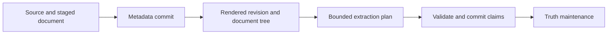

This tutorial builds a small knowledge graph from a fictional architecture
note. You will submit the note, inspect the asynchronous work, find the
components it describes, and check the source of an extracted claim. The
follow-up [updates and conflicts tutorial](/recall/guides/putting-it-together-part2)
adds a second source and investigates what changed.

## Before you start

You need a configured Meerkat Recall server with semantic ingestion ready, `curl`,
and `jq`. For the final evidence lookup, install Node.js 22.19 or newer and
define the `elephant_mcp` helper from [terminal MCP setup](/recall/mcp/overview#try-calls-from-a-terminal).
Follow the [quickstart](/recall/quickstart) first. The isolated `demo-wiki`
server demonstrates stored views; it does not supply a semantic extractor for
this tutorial. Extraction uses the configured model provider and incurs its
normal usage costs.

Use a development space with permission to ingest sources and documents and
read their resulting entities, assertions, and evidence. The authenticated
principal selects the space. Keep the same principal throughout this tutorial.
Do not use a request field to switch an authenticated caller into another space.

Set the server URL. On an authenticated instance, also export `TOKEN` with a
token issued for your space. Leave it unset only for explicit local `SKIP_AUTH`
development.

```bash
export BASE_URL="http://127.0.0.1:3000"

elephant_http() {
  if [ -n "${TOKEN:-}" ]; then
    curl -fsS -H "Authorization: Bearer $TOKEN" "$@"
  else
    curl -fsS "$@"
  fi
}

elephant_http "$BASE_URL/v1/runtime/status" | jq
```

Continue only when `semantic_ingest_ready` is `true`. If it is false, inspect
`issues`, `storage_ready`, `worker_ready`, and `extractor_ready` in that response.
A healthy HTTP listener by itself does not establish ingestion readiness.

## 1. Submit a source with its content

The example describes a system called Cedar. It uses the bundled technical
document extraction skill and gives the extractor a concrete purpose.

```bash
cat > cedar-note.json <<'JSON'
{
  "name": "Cedar architecture note v1",
  "uri": "https://docs.example.com/cedar/architecture/v1",
  "source_type": "web",
  "title": "Cedar architecture",
  "text": "Cedar API depends on Cedar Storage. Cedar Storage uses PostgreSQL. Cedar Worker depends on Cedar Storage. The API accepts requests and the worker processes queued jobs.",
  "collection": "cedar-tutorial",
  "rendition_key": "cedar-architecture-v1",
  "ingest_mode": "graph",
  "extraction_skill": "extraction/technical-docs",
  "extraction_purpose": "Identify named software components and their explicitly stated dependencies."
}
JSON

elephant_http "$BASE_URL/v1/sources/ingest" \
  -H 'Content-Type: application/json' \
  --data-binary @cedar-note.json > cedar-ingest.json
jq . cedar-ingest.json

export SOURCE_ID=$(jq -er '.source_id' cedar-ingest.json)
export DOC_ID=$(jq -er '.doc_id' cedar-ingest.json)
```

The example URL records provenance. This endpoint processes the supplied
`text`; it does not fetch that URL. The response gives you `source_id`, `doc_id`,
and the initial `work_item_id`. Save the receipt rather than constructing IDs.
A successful response means the source was staged and work was enqueued.

<Note>
  A space-level extraction skill or purpose takes precedence over per-document
  hints. Check the resolved guidance in the next step if your space is already
  configured for another domain.
</Note>

## 2. Follow the work to its result

Read the document's processing summary and the source's lifecycle:

```bash
elephant_http "$BASE_URL/v1/docs/$DOC_ID/pipeline-status" | jq
elephant_http "$BASE_URL/v1/sources/$SOURCE_ID" | jq
```

| Observation | Meaning | Next action |
|---|---|---|
| `pending` or `running` extraction | Work is queued or executing | Check again after the worker has had time to progress |
| `completed` extraction | Tracked work is terminal without a failed item; this can include cancellation | Inspect assertions and graph records |
| `failed` extraction | A relevant work item failed | Inspect the work item and worker error before retrying |
| `not_triggered` extraction | No extraction work or assertions are recorded | Check the source mode, lifecycle, and readiness |
| Source `graph_ready` | The source reached graph ingestion | Verify the resulting evidence and entities |
| Source `skipped` or `rejected` | Processing stopped intentionally | Read the source's ingest decision |

See the [state definitions](/recall/api/documents#extraction-state) when interpreting
a terminal result. The document summary also reports `revision`, `nodes_count`, `chunks`, and
`extraction_guidance`. Check `extraction_guidance.skill_id`, `purpose`, and
`resolution_trace` when extraction is looking for the wrong kind of knowledge.
The number of chunks, assertions, and entities depends on the actual output.
A completed pipeline can legitimately produce no useful graph claims.



The extractor processes planned evidence units under its budgets. It does not
promise to read every document in a single model call. Embedding progress is
also distinct from extraction progress.

## 3. Find the committed entities

Search for the component names from the note:

```bash
elephant_http "$BASE_URL/v1/entities/search" \
  -H 'Content-Type: application/json' \
  -d '{"query":"Cedar","limit":20}' > cedar-entities.json
jq . cedar-entities.json
```

Inspect the returned names and types, then copy the actual ID for Cedar API
into `ENTITY_ID`. For example, `export ENTITY_ID='entity:...'` with the complete
returned value. Do not assume the first result is the intended component or
that a familiar display name identifies the same entity in every space.

```bash
elephant_http "$BASE_URL/v1/entities/$ENTITY_ID/context?window_days=30&event_limit=10" \
  | jq
```

The context includes the entity, its incoming and outgoing relationships, and
authorized recent events. Check whether the relationship endpoints correspond
to the components in the note. A dependency may use the canonical predicate
chosen by the space's registry, so inspect the record instead of assuming its
predicate spelling.

If Cedar is absent, inspect the source lifecycle and extraction guidance before
re-ingesting. In a populated space, identity resolution may have reused an
existing component instead of creating a new one.

## 4. Inspect the evidence for a claim

The `get_provenance` convenience path in this tutorial assumes a trusted caller
entitled to all content in the selected development space. The current handler
lacks per-record clearance checks on returned evidence. For restricted readers,
use individually authorized assertion and document reads instead. See
[security boundaries](/recall/concepts/security#authorization-boundaries).

Search assertions from this source:

```bash
jq -n --arg source "$SOURCE_ID" \
  '{source_id:$source,limit:50}' \
  | elephant_http "$BASE_URL/v1/assertions/search" \
      -H 'Content-Type: application/json' --data-binary @- \
  > cedar-assertions.json
jq . cedar-assertions.json
```

For one relevant assertion, check:

- `subject_text`, `predicate_raw`, and `object_text` or `object_literal` describe
  something the note actually says.
- Resolved `subject_entity` and `object_entity` links identify the intended
  components.
- `evidence.revision`, its span, and `quote_hash` identify immutable evidence.
- `resolution_status` describes processing of the claim; it is not independent
  proof that the claim is true.

Fetch a selected assertion by its complete returned ID at
`GET /v1/assertions/{id}`. Read the current source document at:

```bash
elephant_http "$BASE_URL/v1/docs/$DOC_ID" | jq
```

For the immutable evidence quote, keep the same `TOKEN` and use the default
`/mcp` endpoint. Copy the complete relationship ID from the context response
into `RELATIONSHIP_ID`, then use the helper from the prerequisites:

```bash
export MCP_URL="$BASE_URL/mcp"
elephant_mcp --method tools/call --tool-name get_provenance \
  --tool-args-json "$(jq -cn --arg id "$RELATIONSHIP_ID" '{id:$id}')"
```

Inside Inspector's `result.content`, the tool's JSON text contains
`data.chain`, linking assertions, spans, revision metadata, documents,
and available quotes. Compare the returned quote with the claimed dependency.
Treat evidence positions as UTF-8 byte offsets in that revision, not character
positions in a later edit. The current document text is a useful reading view,
but a newer revision cannot validate an older quote's offsets or hash. Missing
evidence is a reason to investigate, not to manufacture a citation.

## What you have established

You now have an ingestion receipt, source lifecycle state, actual graph records,
and inspectable assertion evidence. Those observations establish more than an
HTTP success or a model-generated description of what supposedly happened.

Continue with [updates and conflicts](/recall/guides/putting-it-together-part2) to add a
second architecture note and inspect how Meerkat Recall handles different claims.
For other input formats, use the [ingestion guide](/recall/guides/ingesting-data).
