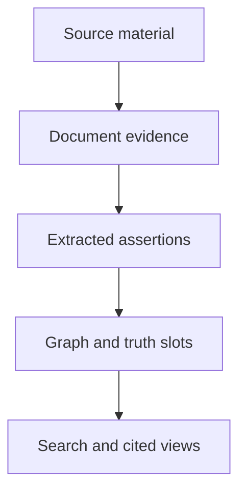

Meerkat Recall is a Rust knowledge system for applications and AI agents. It keeps
source material, extracted claims, and a structured graph together, so a reader
can ask both **"What do we know?"** and **"What evidence supports it?"**

Applications connect through HTTP. Agents use MCP tools to ingest evidence,
search, navigate relationships, and read cited context. Spaces and
attribute-based access control restrict what each caller can see or change.

Recall can serve any application or agent stack through those interfaces. In
Meerkat, Core runs agents and Meta manages the application and its agent memory
lifecycle. Recall adds shared knowledge with sources, relationships and access
rules. You can use it independently or add it to an existing Meerkat application.
See the [Meerkat introduction](https://docs.rkat.ai/introduction) for component choices.

[Recall 0.9.0](https://github.com/lukacf/meerkat-recall/releases/tag/v0.9.0)
is available with exact-pinned Meerkat 0.9.0 dependencies.
Start with [binary installation](/recall/installation) and
[service setup](/recall/operations/service-setup); consult the
[release notes](https://github.com/lukacf/meerkat-recall/releases) for supported
platforms and known limits.

## Follow one piece of evidence

Suppose a project note says, "Alice owns the Project Cedar test plan."

1. A **source** records where that information came from. A **document revision**
   preserves the rendered evidence used for extraction.
2. The pipeline can identify **entities** such as Alice and Project Cedar, and
   extract **assertions** linked to spans of that evidence.
3. Validated artifacts populate the graph. **Truth maintenance** tracks support
   and competing values for eligible subject-predicate slots.
4. Retrieval and **Living Wiki** projections expose this knowledge with citations
   and freshness information, subject to the reader's authorization.

If a later note names a different owner, the useful result is more than a new
string in a database. Meerkat Recall can retain the competing claims and the evidence
behind them. Resolution depends on the predicate, policy, and available
evidence; a selected value is not a guarantee that the underlying claim is true.

Read the [knowledge model](/recall/concepts/overview) for the distinctions between
evidence, claims, graph records, and derived views.

## Start with the experience you need

<CardGroup cols={2}>
  <Card title="Try it locally" icon="rocket" href="/recall/quickstart">
    Run the credential-free demo, then ingest and inspect your own synthetic evidence.
  </Card>
  <Card title="Understand the model" icon="shapes" href="/recall/concepts/overview">
    Learn the vocabulary through one example before exploring individual record types.
  </Card>
  <Card title="Build an integration" icon="code" href="/recall/api/overview">
    Authenticate, scope requests, handle asynchronous work, and paginate HTTP results.
  </Card>
  <Card title="Connect an agent" icon="plug" href="/recall/mcp/overview">
    Choose an MCP profile, discover available tools, and follow a complete workflow.
  </Card>
</CardGroup>

## What to expect

**Extraction is asynchronous and model-driven.** Accepting an ingest queues work.
It does not mean extraction has completed, or that a model will produce a
particular entity or relationship. Inspect processing status and evidence.

**Evidence and derived knowledge have different lifecycles.** Reprocessing can
change extracted results or projections while document revisions retain the
evidence they were built from. See [documents](/recall/concepts/documents) and
[assertions](/recall/concepts/assertions).

**Storage is an operational choice.** SurrealDB is the default durable backend.
The managed embedded `elephant-db` runtime synchronizes acknowledged commits
to a write-ahead log when a persistent destination is configured; explicitly
ephemeral library/test stores remain volatile. The
[deployment guide](/recall/operations/deployment) explains persistence and runtime
configuration.

**This is pre-1.0 software.** Use documentation from the same revision as your
server. The [architecture overview](/recall/architecture/overview) explains component
boundaries, including Meerkat's role in model execution and the MCP transport.
