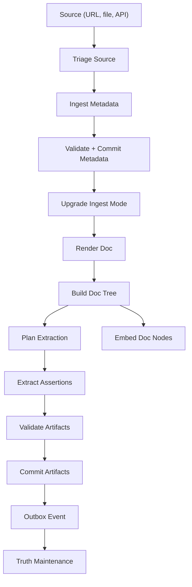

Meerkat Recall's managed runtime runs concurrent worker loops that transform source-backed evidence into a structured knowledge graph. `meerkat-recall serve` runs these loops in-process by default. `meerkat-recall worker` supports separate workers against a shared SurrealDB backend; embedded `elephant-db` requires the managed process because its state cannot be shared between processes. Each loop polls independently and communicates through the work queue and outbox event system.

An ingest receipt confirms acceptance, not completed extraction. Follow the returned source and document IDs through [pipeline status](/recall/api/documents#get-document-pipeline-status), then read the actual claims and evidence. The flow below shows graph-mode ingest; metadata and retrieval modes stop earlier.

## Full Pipeline Flow



## Worker loops

### 1. Work Queue Loop

The primary loop that drives most pipeline stages. It polls for runnable work items, claims them with a lease, and dispatches to the appropriate handler.

- **Poll interval:** configurable (default 5s)
- **Concurrency:** controlled by semaphore (`PIPELINE_MAX_CONCURRENT`, default 8)
- **Lease duration:** 300 seconds by default
- **Dispatches:** source triage, metadata ingest, ingest-mode upgrade, rendering, extraction planning, assertion extraction, artifact validation/commit, truth maintenance, freshness, and reprocessing work kinds

### 2. Truth Maintenance Loop

A dedicated loop that watches the outbox for new events and triggers conflict detection. It tracks a per-space cursor over the `system_event` table.

- **Poll interval:** configurable (`PIPELINE_TRUTH_MAINTENANCE_POLL_INTERVAL`, default 5s)
- **Batch size:** up to 100 events per poll
- **Direct commit:** slots with a single value group commit immediately -- first claims and corroborations (multiple sources agreeing on the same value, evidence merged)
- **Conflict enqueue:** genuinely divergent values are enqueued as `tm_resolve_slot` work items, resolved by LLM adjudication (`PIPELINE_TM_MODEL`, requires `ANTHROPIC_API_KEY`) with deterministic conflict policies as the keyless fallback
- **Sequence reset detection:** automatically rewinds cursor if the event stream is reset

### 3. Embed Worker

Generates vector embeddings for document nodes. Runs only when enabled via configuration.

- **Enable:** `PIPELINE_EMBED_ENABLED=true`
- **Providers:** OpenAI, FastEmbed, or Fake (for testing)
- **Polls** for `doc_node` records that lack embeddings

### 4. Maintenance Sweep Loop

Periodic background maintenance for knowledge graph hygiene.

- **Interval:** every 300 seconds (`PIPELINE_MAINTENANCE_POLL_INTERVAL`)
- **Tasks:** identity sweep (find/merge duplicate entities), predicate hygiene (normalize names, create aliases), entity type consolidation

### 5. Retention and work-history archival

Legacy cleanup uses `PIPELINE_RETENTION_POLL_INTERVAL` (default 3600 seconds).
Independent work-history archival starts immediately and then runs every
`PIPELINE_WORK_HISTORY_POLL_INTERVAL` seconds (default 60). It moves old terminal
jobs and completed attempts to cold tables in bounded passes while preserving
historical reads and idempotency.

### 6. Knowledge-view invalidation

The managed API runtime independently watches semantic outbox events for
knowledge-view invalidation and wiki change scheduling. It does not depend on
the truth-maintenance worker being enabled. Its interval is
`ELEPHANT_KNOWLEDGE_VIEW_EVENT_POLL_SECS` (default 5 seconds).

## How Work Items Flow

Most top-level pipeline stages are modeled as work items with a specific `kind`. A few structural helpers, such as document-tree construction, run inside a dispatched stage while still appearing in the runtime flow:

<Steps>
  <Step title="Ingest Source Stub">
    Creates a source record for tracking. Enqueues `triage_source`.
  </Step>
  <Step title="Triage Source">
    A triage plugin decides the ingestion mode (metadata, retrieval, graph, skip). Budget enforcement may downgrade the mode. The source-first flow stages metadata first, then `upgrade_ingest_mode` determines whether to stop, materialize evidence, or continue into extraction.
  </Step>
  <Step title="Ingest and Commit Metadata">
    `ingest_metadata` stages normalized source metadata, then `validate_artifacts` and `commit_artifacts` commit the metadata artifact before the source lifecycle advances.
  </Step>
  <Step title="Upgrade Ingest Mode">
    `upgrade_ingest_mode` applies the requested depth: metadata mode stops after metadata, retrieval mode materializes searchable evidence, and graph mode continues through extraction.
  </Step>
  <Step title="Render Doc">
    Transforms the document into an immutable `doc_revision` using the appropriate renderer (Markdown, HTML, plain text, email), then builds the document-node tree before extraction planning.
  </Step>
  <Step title="Build Doc Tree">
    Splits the revision into a hierarchy of `doc_node` records (document, section, paragraph, chunk). This is executed by the render stage helper; chunk nodes are later embedded.
  </Step>
  <Step title="Plan Extraction">
    Selects which nodes to extract from, estimates token costs, and persists an extraction plan artifact. Enqueues one `extract_assertions` work item per selected node.
  </Step>
  <Step title="Extract Assertions">
    Runs the LLM extractor on a node to produce candidate assertions and event data. These are staged, validated, and only then committed into canonical assertions, entities, relationships, attributes, and events.
  </Step>
  <Step title="Validate and Commit Artifacts">
    `validate_artifacts` checks staged `knowledge_candidates` and `commit_bundle` payloads. `commit_artifacts` performs the canonical writes and emits the outbox event that truth maintenance consumes.
  </Step>
  <Step title="Truth Maintenance">
    The TM loop picks up the outbox event, detects conflicts with existing truth slots, and either commits directly or enqueues resolution work.
  </Step>
</Steps>

<Note>
  The active runtime uses a staged artifact boundary: `extract_assertions` writes candidates, `validate_artifacts` checks them, and `commit_artifacts` performs canonical writes.
</Note>

## Configuration

<CodeGroup>
```bash Environment Variables
# Work queue
PIPELINE_MAX_CONCURRENT=8
PIPELINE_WORK_QUEUE_LEASE_SECS=300
PIPELINE_WORK_QUEUE_POLL_INTERVAL=5

# Truth maintenance
PIPELINE_TRUTH_MAINTENANCE_POLL_INTERVAL=5
PIPELINE_TM_MODEL=claude-sonnet-4-5   # conflict adjudication (needs ANTHROPIC_API_KEY)

# Promotion / summarization
PIPELINE_PROMOTION_DISAMBIGUATION_MODEL=claude-sonnet-4-5
PIPELINE_SUMMARIZER_MODEL=claude-sonnet-4-5

# Embeddings
PIPELINE_EMBED_ENABLED=true
PIPELINE_EMBED_PROVIDER=openai
PIPELINE_EMBED_MODEL=text-embedding-3-small
PIPELINE_EMBED_DIMS=1536

# Maintenance
PIPELINE_MAINTENANCE_POLL_INTERVAL=300
```
</CodeGroup>
