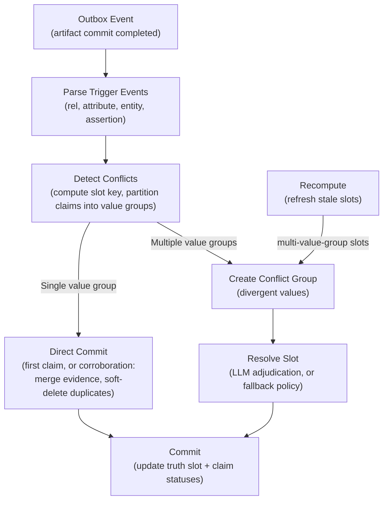

Truth maintenance (TM) keeps the knowledge graph consistent as new assertions arrive. When multiple sources make claims about the same subject-predicate slot, TM compares the **values**: agreeing claims corroborate each other and merge, while genuinely divergent values form a conflict that is adjudicated -- by an LLM when an API key is available, by deterministic policies otherwise -- and recorded in a truth slot.

## Event Flow



<Steps>
  <Step title="Trigger Events">
    The TM loop polls `system_event` for artifact commit outbox events. Each event contains `RecordRef` entries that are mapped to trigger types: `Rel`, `Attribute`, `Entity`, `Assertion`, or `Predicate`.
  </Step>
  <Step title="Detect Conflicts">
    For each rel or attribute trigger, the system computes a **slot key**, loads the slot's claims, and partitions them into **value groups** by exact value equality. A single value group is committed directly -- either a first claim or a *corroboration* (multiple sources agreeing), which merges evidence into a winner and soft-deletes the duplicates without closing any validity window. Multiple value groups create or update a conflict group. Detection is deterministic and replay-stable; it never calls an LLM.
  </Step>
  <Step title="Resolve Slot">
    Real conflicts are adjudicated by an LLM that sees the rendered claim values (see below). Deployments without an API key fall back to the predicate's deterministic conflict policy. Verdicts are memoized per claim-set hash on the conflict group, so an unchanged claim set is never re-adjudicated.
  </Step>
  <Step title="Commit">
    The winning value is written to the truth slot. Superseded claims get their `claim_status` updated and their validity windows closed, preferring dates the adjudicator extracted from the claim values over ingest timestamps. If the group's claim set changed since resolution, the commit no-ops with a warning. An audit log entry carries the rationale.
  </Step>
</Steps>

## Slot Key Format

A truth slot is uniquely identified by its **slot key**, which encodes the subject, object, predicate, and security context:

For **rels** (entity-to-entity):
```
subject_entity_id::object_entity_id::predicate_id::security_hash
```

For **attributes** (entity-to-literal):
```
subject_entity_id::predicate_id::security_hash
```

For **rel sets** (all objects of one subject-predicate pair):
```
subject_entity_id::__rel_set__::predicate_id::security_hash
```

Attributes with a context bucket insert that bucket before the security hash.
Treat slot keys as server-generated identifiers rather than constructing them
in a client.

The `security_hash` is a deterministic SHA-256 of the security envelope (policy
ID, level, sorted labels, and sorted handling tags). Claims in different
envelopes occupy separate truth slots, so this comparison does not detect
contradictions across those boundaries.

### Cross-object conflicts

Because rel slot keys include the object, "Alice works_at ExampleCo" and "Alice works_at ExampleLabs" occupy different rel slots. The **rel_set** slot exists to catch exactly this: when a subject has more than one distinct object for a predicate whose cardinality is configured as `One` -- or whose semantics are unknown -- a rel_set conflict group is created. Predicates configured with cardinality `Many` and event-like predicates never produce rel_set groups. Without an adjudicator, rel_set groups resolve as coexist (all values approved) rather than guessing a winner.

## LLM Adjudication

With `ANTHROPIC_API_KEY` set, the pipeline binary constructs a slot adjudicator (`TmContext`) that is the primary resolution path for real conflicts:

- **Model:** `PIPELINE_TM_MODEL` (default `claude-sonnet-4-5`)
- **Prompt:** `crates/pipeline/prompts/tm_adjudication.txt`
- **Contract:** meerkat structured output with a strict schema and retries; malformed output after retries falls back to the deterministic policy with a warning
- **Input:** per-claim rendered values, confidences, evidence counts, source timestamps and time basis, plus predicate semantics when known

The verdict decision is one of:

| Decision | Effect |
|----------|--------|
| `corroborate` | Claims agree after all (e.g. formatting variants); evidence merges into a winner, duplicates soft-deleted, no windows closed |
| `single_winner` | One claim wins; the rest are superseded |
| `coexist` | All values valid simultaneously; every ranked claim is approved |
| `supersede` | Newer claim replaces older; the verdict's LLM-extracted validity dates take precedence over ingest-time heuristics when closing windows |
| `needs_review` | Genuine ambiguity; flagged for human review (also memoized until the claim set changes) |

Verdicts may include `equivalent_groups` (same value, different formats); members merge into their group winner like corroboration. When the predicate has no registered semantics, the verdict **must** propose semantics (cardinality, temporal model, conflict policy), which are persisted to the predicate registry with `semantics_status: llm_proposed` -- never overwriting operator-configured semantics, revisable by later adjudications, and emitting the predicate-registry outbox event so dependent slots recompute.

Event-slot conflicts flow through the same adjudicator. On the event commit path, coexist verdicts approve **all** ranked values, and the event reject floor applies only to non-adjudicated resolutions.

## Fallback Conflict Policies

Without an adjudicator (or when adjudication fails), the predicate's conflict policy from the `predicate_registry` applies:

| Policy | Behavior |
|--------|----------|
| `AllowParallel` | Both claims coexist. The truth slot shows all values with confidence ranking. This is the default. |
| `SupersedeByRecency` | The newer timestamp wins. The older claim gets its validity window closed. |
| `SplitByContext` | Partitions claims by supplied context. The current relationship/attribute adapter supplies no context, so configuring this policy alone does not infer role-specific groups. |
| `RequireMoreEvidence` | No automatic resolution. The conflict is flagged for human review. |

<Note>
  Keyless deployments never supersede a value unless the predicate has configured semantics that call for it. There are no per-predicate hardcoded defaults; semantics come from the registry (operator-configured or LLM-proposed).
</Note>

## How Assertions Compete

When the TM system detects divergent values, it gathers the competing rels or attributes into a conflict group. Resolution then:

1. **Loads all claims** for the slot, including their rendered values.
2. **Checks the memo**: if the claim-set hash matches the group's `adjudicated_claim_set_hash`, the previous verdict stands and no LLM call is made.
3. **Adjudicates** (LLM) or **applies the conflict policy** (fallback) to rank or partition the claims.
4. **Updates claim statuses**: accepted rel/attribute claims get `ClaimStatus::Approved` (`approved` on the wire), superseded claims get `ClaimStatus::Superseded`, and corroborated duplicates are merged and soft-deleted. A `needs_review` outcome does not declare a winner.
5. **Writes the truth slot** with the current value(s), a confidence score, and the rationale.

## Recompute

The `tm_recompute` work kind refreshes stale truth slots. A slot becomes stale when:

- An entity involved in the slot is merged or deleted
- A rel or attribute is updated or retracted
- Predicate semantics change (including newly learned `llm_proposed` semantics)
- A freshness sweep flags the slot for recomputation

Recompute re-partitions the current claims for each slot. It **never calls the LLM inline**: single-value-group slots are committed deterministically within the recompute loop, while multi-value-group slots get their conflict group upserted and a `tm_resolve_slot` work item enqueued per group. This separates model latency from recomputation; it does not guarantee a fixed completion time under every workload.

<Warning>
  Recompute can change the winning value of a truth slot if claims have been added or removed since the last resolution. This is by design -- truth slots are derived state, not source of truth. The reverse does not hold: re-corroborating an already-superseded value does not reopen adjudication while the conflict group's claim set is unchanged.
</Warning>
