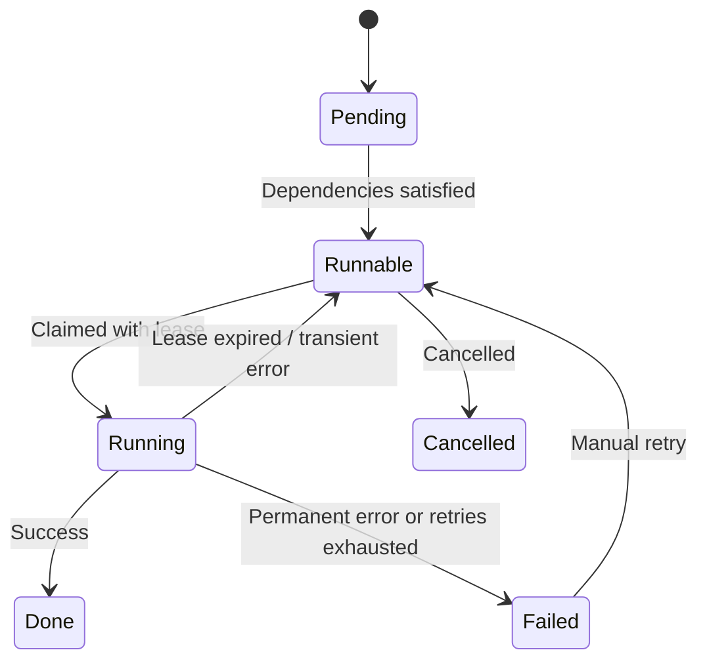

The work queue is a durable, priority-ordered job scheduler that drives the top-level pipeline. Active dispatched stages are modeled as work items with a specific `kind`; structural helpers, such as document-tree building, run inside those dispatched stages. The queue manages claiming, execution, and retry. Failed work remains inspectable with its error and execution history.

## Work Item Lifecycle



| Status | Description |
|--------|-------------|
| `pending` | Waiting for dependencies (DAG edges). Not yet eligible to run. |
| `runnable` | Dependencies satisfied. Ready to be claimed by a worker. |
| `running` | Currently executing. Protected by a lease with an expiry time. |
| `done` | This stage completed successfully. Downstream stages may still be pending. |
| `failed` | A permanent failure, lifecycle timeout, or exhausted transient retry budget. |
| `cancelled` | Cancelled work. |

The table uses JSON status values. The Rust enum variants use title case.

## Active Work Kinds

### Ingestion

| Work Kind | Description |
|-----------|-------------|
| `ingest_source_stub` | Creates a source record stub for later processing |
| `triage_source` | Plugin decides ingestion mode (metadata, retrieval, graph, skip); budget enforcement may downgrade |
| `ingest_metadata` | Extracts and stores metadata fields from the source |
| `upgrade_ingest_mode` | Advances the source from metadata-only ingest into retrieval or graph processing when requested |

### Evidence (Document Processing)

| Work Kind | Description |
|-----------|-------------|
| `render_doc` | Transforms a document into an immutable `doc_revision` via the appropriate renderer |

`render_doc` also invokes the document-tree builder, which splits the active revision into hierarchical `doc_node` records. That helper is part of the active runtime flow but is not a standalone dispatched work item in the current worker match table.

### Extraction

| Work Kind | Description |
|-----------|-------------|
| `plan_extraction` | Selects nodes for extraction, estimates token costs, creates an extraction plan |
| `extract_assertions` | Runs LLM extraction on a node and stages candidate artifacts for later validation/commit |
| `validate_artifacts` | Validates staged metadata, extraction, resolution, and commit artifacts before canonical writes |
| `commit_artifacts` | Commits typed artifact bundles into sources, assertions, graph records, events, and outbox rows |
| `validate_resolution_patches` | Compatibility dispatch surface for resolution patch validation; primary graph commits use `validate_artifacts` |
| `commit_resolution_patches` | Compatibility dispatch surface for resolution patch commits; primary graph commits use `commit_artifacts` |

### Truth Maintenance

| Work Kind | Description |
|-----------|-------------|
| `tm_detect_conflicts` | Partitions slot claims into value groups from outbox events; agreeing claims corroborate (direct commit), divergent values form conflict groups |
| `tm_resolve_slot` | Resolves a conflict group via LLM adjudication (memoized per claim set) or the predicate's fallback conflict policy |
| `tm_commit` | Persists truth slot changes and updates claim statuses; no-ops if the claim set changed since resolution |
| `tm_recompute` | Recomputes stale truth slots: single-value-group slots commit inline, conflicted slots enqueue `tm_resolve_slot` (never calls the LLM inline) |

### Maintenance

| Work Kind | Description |
|-----------|-------------|
| `freshness_sweep` | Computes staleness scores across truth slots and flags stale ones for recompute |
| `execute_reprocess_job` | Runs a batch reprocessing job through the active render, doc-tree, extraction, and artifact-commit path |
| `reconcile_living_wiki` | Reconciles derived wiki articles under a durable space-wide service grant |

## Lease-Based Claiming

Workers claim items using optimistic concurrency control:

1. **Poll**: the work queue selects runnable items by descending priority within its claim lanes. The active worker reserves bounded capacity for extraction before filling remaining permits from the general queue, so global priority alone does not determine execution order.
2. **Filter**: items with a `run_after` timestamp in the future are skipped.
3. **Claim**: an atomic conditional update sets the status to `Running` and records the `worker_id` and `lease_expires_at`.
4. **Execute**: the worker runs the work item handler.
5. **Complete/Fail**: the worker marks the item as `Done` or `Failed`.

<Note>
  The default lease duration is **300 seconds** (5 minutes). If a worker crashes without completing, the lease expires and the item becomes claimable again after a 60-second grace period.
</Note>

### Expired Lease Recovery

Before each poll cycle, the work queue checks for running items whose leases have expired (with a 60-second grace period to avoid races). Expired items are released back to `Runnable` status so another worker can pick them up.

If a worker finishes work after its lease was recovered, it attempts a **force-complete** since the work was already done.

## Retry with Exponential Backoff

When a work item fails with a transient error (DB write conflict, connection reset, rate limit, timeout), the system applies exponential backoff:

```
delay = min(base_delay * 2^(attempt-1), max_delay)
```

| Parameter | Default |
|-----------|---------|
| Base delay | 10 seconds |
| Max delay | 120 seconds |
| Max attempts | `PIPELINE_WORK_TRANSIENT_RETRY_MAX_ATTEMPTS`, default 3 in the active worker |

Transient errors are identified by pattern matching on error messages and types:

- `read or write conflict` / `transaction can be retried`
- `temporarily unavailable` / `timeout` / `timed out`
- `rate limit` / `too many requests`
- `connection reset` / `broken pipe`
- `StorageError::Conflict` / `StorageError::ConnectionError`
- `PipelineError::LeaseConflict`

<Warning>
  Non-transient errors (validation errors, security violations, budget exceeded) are **not** retried. The item is failed immediately.
</Warning>

The outer `PIPELINE_WORK_ITEM_TIMEOUT_SECS` deadline is handled separately: a
handler that exceeds that lifecycle bound is marked failed. Managed wiki
reconciliation has its own longer bound and extends its lease accordingly.

## Inspect and retry failed work

1. List work items with `status: "failed"` using `list_work_items` on
   `/mcp/full`, or `GET /v1/work-items?status=failed`. Inspect `kind`,
   `last_error`, and `attempts`; use the recorded IDs to correlate worker logs.
2. Correct the cause, such as unavailable credentials, a missing skill,
   invalid input, or storage contention.
3. Call `retry_work_item` with `{"id":"work_item:<returned UUID>"}` on
   `/mcp/full`. The caller needs `write:work_item` in the same space. This
   resets a **failed** item to `runnable`, clears its lease and error, and
   resets the attempt count. It does not retry a currently running item.
4. Verify that this stage and its dependent stages finish. A successful retry
   request means the work was queued, not that the document finished processing.

The repository also defines a `work_deadletter` record and a dead-letter
library helper. The active worker failure path marks the work item `failed`;
it does not automatically call that helper or guarantee a separate dead-letter
record. Monitor failed work items as the operational failure surface.

## Priority

Work items have an integer `priority` field. Higher values are claimed first. Typical priority assignments:

| Work Kind | Priority |
|-----------|----------|
| `render_doc` | 10 |
| `validate_artifacts` | 8 |
| `commit_artifacts` | 8 |
| `plan_extraction` | 5 |
| `extract_assertions` | 5 |
| `tm_resolve_slot` | 8 |
| `tm_commit` | 8 |
| `freshness_sweep` | 1 |


## Indexed queue and historical work

Migration 028 supplies indexes for scheduler, idempotency, source, and dependency
queries. Runnable counts are exact aggregates rather than the selector's
bounded candidate count. Migration 029 introduces durable cold work history.
Archival retains public IDs, provenance, usage, idempotency lookup, and failed
dependency barriers; retry restores the original work item to the active queue.

See [Deployment](/recall/operations/deployment) for engine deadlines and bounded
archival settings. Measure runtime-status and representative search latency
under the intended workload; a lightweight health response alone does not
establish scheduler capacity.
